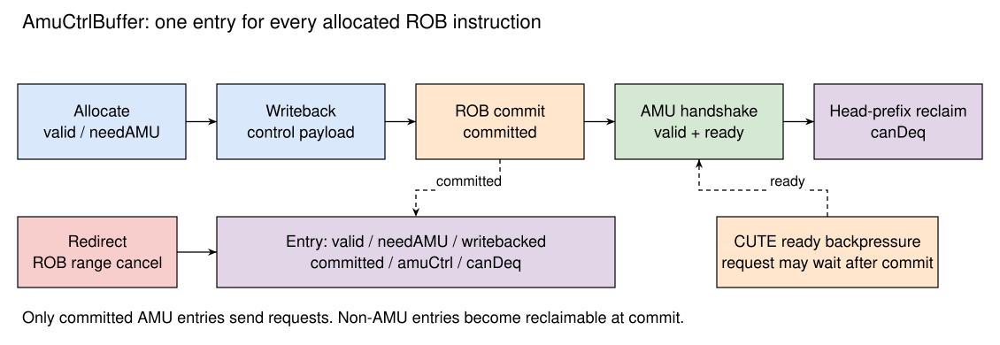

# AmuCtrlBuffer

- 版本：V2R2A
- 状态：OK
- 日期：2026/10/13
- commit：[XSAI e8fb1a14](https://github.com/OpenXiangShan/XSAI/tree/e8fb1a14fc85e05696e8b69a4ebfd2ca7cd1672f)

## 术语说明

Table: 术语说明

| 名称 | 描述 |
| ---- | ---- |
| AMU | 矩阵加速单元控制接口的命名 |
| amuCtrl | 矩阵运算、访存、清零或 release 的控制请求 |
| needAMU | 该项是否需要向 CUTE 发送控制请求 |
| canDeq | 该项已完成本缓冲所需的处理，可以回收 |

## 设计规格

- 与 ROB 并行，容量为 RobSize，使用相同的分配索引。
- 同步接收 ROB 分配、写回、提交和重定向信息。
- 只有已写回且已提交的矩阵控制请求才能发送到 CUTE。
- CUTE 不能接收请求时，保存请求并向 ROB 分配形成背压。
- 输出有 CommitWidth 个候选通道，由 XSCore 固定优先级仲裁器汇聚为单通道。

## 功能

控制核中的矩阵功能单元完成参数检查和控制信息生成，然后将 amuCtrl 写回。AmuCtrlBuffer 保存这些信息，等待对应指令从 ROB 正常提交后，才与 CUTE 进行握手。控制核的乱序执行和矩阵单元的实际执行由此分开。

ROB 提交、CUTE 接受控制请求、CUTE 完成矩阵操作是三个不同事件。ROB 提交后，请求仍可能因 CUTE 背压保存在本缓冲中。软件可通过 mrelease / macquire 等待更老 Store 及其依赖链完成；当前 Release 不保证所有无关 Load / Compute 已清空，详见 [Release 的同步语义](../../cute/TaskController.md#sec:cute-release)。

## 整体框图

{width=85%}

## 表项

Table: AmuCtrlEntry 信号列表

| 信号 | 描述 |
| ---- | ---- |
| valid | 已分配该项 |
| needAMU | 需要发送 AMU 控制请求 |
| writebacked | 控制信息已写回 |
| committed | 对应 ROB 项已提交 |
| amuCtrl | 待发送的控制信息 |
| canDeq | 已完成处理，可以按序回收 |

每个有效 ROB 分配都在缓冲中占位，包括普通非矩阵指令。非矩阵指令提交时直接设置 canDeq；矩阵指令需等待控制请求握手后设置 canDeq。

## 分配与写回

分配使用 ROB 的 allocatePtr。只有 ROB 接收了该指令且没有重定向时，才清零并分配对应缓冲项。写回根据 robIdx.value 匹配表项，保存 amuCtrl 并设置 writebacked。启用 DiffTest 时，在缓冲中补入该指令的 PC 和 coreid。

缓冲根据有效项数和当前请求数判断容量。ROB 入队预留 RenameWidth 项，提前反馈给 Dispatch 的条件预留 2×RenameWidth 项，两个接收条件均寄存后输出。

## 提交与发送

ROB 正常提交后设置 committed。发送请求的条件为：

```text
valid && needAMU && writebacked && committed && !canDeq
```

从缓冲出队指针开始选择 CommitWidth 个候选项。XSCore 的固定优先级仲裁器优先选择较老的有效请求，因此每周期至多向 CUTE 发送一个请求。请求 fire 后设置 canDeq，下一次按序回收时释放该项。

出队指针按连续 canDeq 项的数量推进，最多回收 CommitWidth 项。普通指令占位可以与已完成握手的矩阵项一起回收，回收宽度不等于矩阵请求发送宽度。

## 重定向与异常

重定向时，根据 ROB 给定的环形区间清除受影响项，无需 walk 重建控制信息。已经提交、仍等待 CUTE 的较老请求保留。该操作不会回滚 CUTE 中已接受的任务。

矩阵指令的参数非法或访存异常通过现有异常通路进入 ROB。未正常提交的指令不能满足发送条件，其控制信息在重定向时清除。矩阵寄存器保存恢复和已提交任务的完成同步需要由对应的软件协议处理，不能把 ROB 冲刷视为 CUTE 任务取消。

实现见 [AMUCtrlBuffer.scala](https://github.com/OpenXiangShan/XSAI/blob/e8fb1a14fc85e05696e8b69a4ebfd2ca7cd1672f/src/main/scala/xiangshan/backend/rob/AMUCtrlBuffer.scala)。
