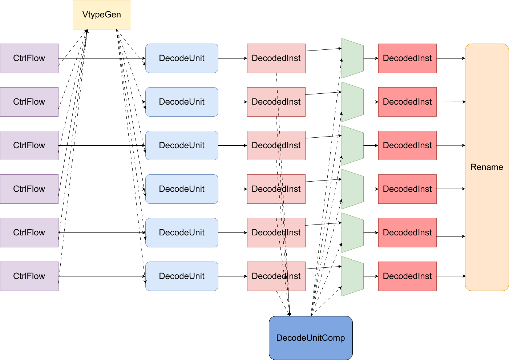
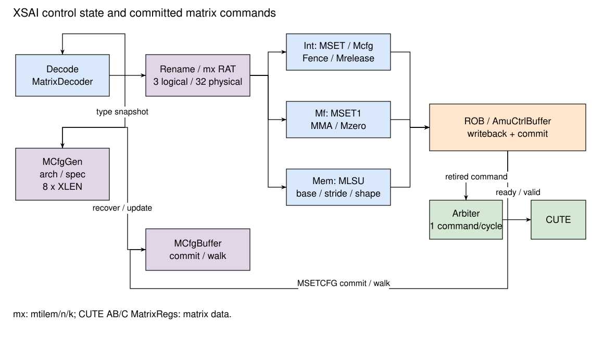

# XiangShan Decode 设计文档

- 版本：V2R2A
- 状态：OK
- 日期：2026/10/13
- commit：[XSAI e8fb1a14](https://github.com/OpenXiangShan/XSAI/tree/e8fb1a14fc85e05696e8b69a4ebfd2ca7cd1672f)

## 术语说明

Table: 术语说明

| 缩写 | 全称            | 描述                            |
| ---- | --------------- | ------------------------------- |
| -    | Decode Unit     | 译码单元                        |
| uop  | Micro Operation | 微操作                          |
| -    | numOfUop        | 一条指令拆分出的uop数量 |
| -    | numOfWB         | 一条指令拆分出的uop中需要写回的指令的数量 |
| -    | vtypeArch       | 最新提交的向量指令vtype配置     |
| -    | vtypeSpec       | 当前向量指令vtype配置           |
| -    | walkVType       | 发生重定向时，回滚并恢复的vtype |


## 子模块列表

Table: 子模块列表

| 子模块 | 描述 |
| ---- | ---- |
| DecodeUnit | 译码单元 |
| DecodeUnitComp | 向量指令拆分处理模块 |
| FPDecoder | 浮点指令译码模块 |
| UopInfoGen | 指令拆分类型、数量生成单元 |
| VecDecoder | 向量指令译码模块 |
| VecExceptionGen | 向量异常检查模块 |
| VTypeGen | 向量指令vtype配置生成模块 |
| MatrixDecoder | 矩阵指令译码表 |
| MCfgGen | 矩阵类型配置及重定向恢复 |

## 设计规格

- 新增向量配置生成模块，向量译码模块，向量指令拆分模块，向量异常检查模块。所有向量指令均进行指令拆分并进入decoderComp
- 支持同一拍内对6条标量指令同时进行译码
- 支持同一拍内对最多1条向量指令进行译码
- 部分指令进行转译处理
  - zimop指令，转译为src为x0，imm为0的addi指令
  - 读vlenb指令，转译为src为x0，imm为VLEN/8的addi指令
  - 读vl指令，转译为读vl寄存器写标量寄存器的vset指令
- 读只读权限的csr时，不再置waitForward和blockBackward信号，支持乱序执行
- 其余功能同南湖

## 功能

对指令进行译码，将指令32bits编码转换为指令的控制信号。指令如果是向量指令或AMO_CAS指令，需进行指令拆分。指令拆分的过程是将指令拆分为1个或多个uop，并根据拆分类型对源寄存器号、源寄存器类型、目标寄存器号、目标寄存器类型、使用的功能单元、操作类型进行新的赋值。译码完成后会将带有控制信息的指令传入rename模块，rename模块根据源寄存器号和源寄存器类型进行重命名分配物理寄存器。会在译码阶段对异常指令、异常虚拟化指令进行检查，并将对应的exceptionVec中的信号拉高

## 整体设计

译码通过例化6个DecodeUnit模块对输入的指令进行译码，DecodeUnit会输出指令是否为向量指令的信号，如果是向量指令，则需要将其传入复杂译码器decoderComp进行指令拆分。
由于向量指令需要经过DecodeUnit和UopInfoGen进行译码后再进入复杂译码器导致关键路径较长，指令进入复杂译码器后会先暂存一拍，在下一拍进行向量异常检查和指令拆分，会转换为等于等于1条uop，如果uop超过6条，则需要多拍才能完成译码。如果剩余的uop可以在
当拍完成译码，会在当拍将需要译码的向量指令传入decoderComp。
假设rename ready，根据传入的指令的顺序可分为以下几种情况：

  1. 标量指令：直接进行译码
  2. 向量指令：decoderComp ready时将向量指令传入decoderComp进行指令拆分，只能处理一条向量指令
  3. 向量指令+标量指令：decoderComp ready时将向量指令传入decoderComp进行指令拆分，只能处理一条向量指令，无法同时处理标量指令
  4. 标量指令+向量指令：向量指令前的标量指令直接进行译码。decoderComp ready时将向量指令传入decoderComp进行指令拆分，只能处理一条向量指令
  5. 指令拆分后的uop+标量指令：假设当拍有n个拆分后的uop需要rename，同时有m个标量指令需要rename，n+m<=6，直接进行译码，否则只译码6-n个标量指令
  6. 指令拆分后的uop+向量指令：处理向量指令拆分后的uop同向量的情况
  7. 指令拆分后的uop+向量指令+标量指令：同标量指令+向量指令的情况
  8. 指令拆分后的uop+标量指令+向量指令：标量指令的处理同指令拆分后的uop+标量指令的情况，向量指令的处理同向量指令情况

## 整体框图



## 接口列表

见接口文档

## 二级模块 VTypeGen

VTypeGen模块主要用于维护当前译码的向量指令需使用的vtype配置，每当执行vset指令或发生重定向需要回滚时，更新VTYpeGen中存储的vtype信息。

### 输入

- 来自前端的指令流中的32bits指令信息;
- 来自rob中vtype buffer的vtype回滚信息;
- 来自rob中vtype buffer的vtype提交信息；
- 来自backend的vsetvl指令的vtype信息，由于vsetvl指令的vtype信息需要通过读寄存器而不是译码获得，因此在vsetvl指令写回时，会将vtype信息传递给vtypeGen。

### 输出

输出到Decode Unit的vtype信息（当前处于译码阶段向量指令使用的vtype配置）

### 设计规格

vtypeSpec更新存在4种情况：

1. vsetvl指令提交时，vtypeSpec更新为vsetvl指令的vtype，其中vsetvl指令的vtype值在其写回时获得。由于vsetvl指令会flush流水线，因此不会和其余情况冲突
 
2. 重定回滚的过程中，vtypeSpec更新为vtype buffer传入的walkVType

3. 重定向开始时，vtypeSpec更新为Arch vtype

4. 译码的指令存在vsetivli或vsetvli指令且没有发生异常时,
vsetivli指令和vsetvli指令的vtype信息可通过立即数字段获得，VTypeGen中存在一个简单的译码器，用于判断输入的指令中是否包含这两种指令。如果存在这两种vset指令，会通过一个PriorityMux选择出第一个vset指令，通过`VsetModule`模块解析出vtype信息。


```scala
  when(io.commitVType.hasVsetvl) {
    vtypeSpecNext := io.vsetvlVType
  }.elsewhen(io.walkVType.valid) {
    vtypeSpecNext := io.walkVType.bits
  }.elsewhen(io.walkToArchVType) { 
    vtypeSpecNext := vtypeArch
  }.elsewhen(inHasVset && io.canUpdateVType) {
    vtypeSpecNext := vtypeNew
  }
```

vtypeArch更新存在2种情况：
1. vsetvl指令提交时，vtypeArch更新为vsetvl指令写回的vtype
2. vsetivli指令或vsetvli指令提交时，vtypeArch更新为从vtype buffer传入的vtype提交信息

## 矩阵指令译码

MatrixDecoder 在启用 MatrixExtension 时加入统一译码表，矩阵指令通过简单译码路径生成单条微操作。向量 BF16 和 exp2 指令使用向量拆分路径。

Table: 矩阵指令译码分类

| 类别 | 指令 | 功能单元 | 关键控制 |
| ---- | ---- | -------- | -------- |
| 类型配置 | msetcfg、mgetcfg | mcfg | msetcfg 阻塞后继并在提交后 flush |
| 上下文初始化 | minit | csr | 等待前序，阻塞后继 |
| 规模配置 | msettilem/n/k 及立即数形式 | msetmtilexiwf | 写对应 mx 逻辑项 |
| 矩阵访存 | A/B/C load/store 及转置形式 | mls | 读整数地址、stride 和 mx 规模 |
| 整寄存器访存 | mla.whole、mlb.whole、mlc.whole、msc.whole | mls | 只读基址，关闭 stride 和规模依赖 |
| 乘法累加 | mmacc | mma | 读三个 mx 规模和三个 mcfg 快照 |
| 清零 | mzero | marith | 无数据源读取 |
| 完成同步 | mrelease | mrelease | 构造提交后发送的控制请求 |
| 等待、重置和内存同步 | macquire、msyncregreset、mfence | fence | 采用各自的顺序控制属性 |

MatrixDecoder 的有效表共 31 个指令模式，整寄存器访存包含 mla.whole、mlb.whole、mlc.whole 和 msc.whole。rocket-chip 定义的 msa.whole、msb.whole 编码未接入该译码表。

`needAmuCtrl` 对 mma、marith、mls、mrelease 置位。`mxWen` 在写规模状态时置位，矩阵乘法和加载指令的 mxWen 为 0。MMA 的三个源规模依次为 mtilem、mtilen、mtilek；MLS 根据 A/B/C 类别选择两项，whole-register 形式按寄存器几何生成规模。

### 立即数与状态读转译

Table: 矩阵相关立即数

| 类型 | 原始字段 | 用途 |
| ---- | -------- | ---- |
| IMM_MSET | instr[24:15] | 10 位规模立即数 |
| IMM_MSETVAL | instr[24:20] | 5 位同步寄存器选择 |
| IMM_CSRCONST | instr[31:12] | 常量 CSR 读转译 |
| IMM_MATRIXREG | instr[22:20]、[17:15]、[9:7] | ms2、ms1、md 的三个 3 位 selector |

读 mtilem/n/k 转为读 mx、写整数寄存器的专用功能单元路径；读 tlenb、trlenb、alenb、msync 转为 x0 加常量的 ALU 路径。这些读操作取消普通 CSR 访问的等待前序和阻塞后继属性。

### 类型配置生成与恢复

每个 DecodeUnit 接收 [MCfgGen](./MCfgGen.md) 输出的当前类型表。msetcfg、mgetcfg、MMA 和 MLS 按指令 selector 读取相应配置项，原始值随指令传到执行阶段。ROB 通过 MCfgBuffer 返回提交和 walk 更新；恢复期间暂停译码。

### 异常处理

Mma、Mcfg、MLSU 在执行阶段取得类型和规模操作数，完成对应的合法性检查。CSR 权限模块根据 MS 状态检查矩阵控制 CSR 的访问权限。DecodeUnit 对普通矩阵指令及上述状态读转译未启用 MS=Off 非法指令判断。



## 二级模块 DecodeUnit

### 输入输出

- **输入**  
     - DecodeUnitEnqIO：前端传入的指令流信息，向量指令使用的vtype、vstart信息
     - CustomCSRCtrlIO：csr控制信号
     - CSRToDecode：csr控制信号
- **输出**  
     - DecodeUnitDeqIO：译码后的指令信息、是否是向量指令、指令拆分数量

### 功能

该模块是香山后端的译码单元，该模块将control flow转换为信息更丰富的微操作，包含源寄存器号、源寄存器类型、目标寄存器号、目标寄存器类型、立即数类型、使用的功能单元类型、操作类型等信息。

### 设计规格

1. **译码信息**  
   - **XSDecode**  
     DecodeConstants中定义了decodeArray，将指令的32位编码转化为XSDecode，包含以下信息：

      - srcType0: 源寄存器0的类型
      - srcType1: 源寄存器1的类型
      - srcType2: 源寄存器2的类型，用于fma指令
      - fuType: 功能单元类型
      - fuOpType: 操作类型
      - rfWen: 是否写回标量寄存器
      - fpWen: 是否写回浮点寄存器
      - vfWen: 是否写回向量寄存器
      - isXSTrap：是否是XSTrap指令
      - noSpecExec：是否是可以乱序执行，即不需要等待前面的指令提交完成再执行
      - blockBackward：是否阻塞后面的指令，即需要等待当前指令提交完成后续指令才能进入rob
      - flushPipe：是否需要清空流水线，即当前指令提交完成后需要清空流水线
      - canRobCompress：指令是否支持rob压缩(对于不会触发异常的指令，其不处于FTQ的边界时，我们认为它是可以进行Rob压缩的)
      - uopSplitType：指令拆分类型。标量指令拆分类型均为UopSplitType.SCA_SIM无需拆分，向量指令和AMO_CAS指令需要拆分；向量指如果令仅需要拆分出一条uop且无需对指令控制信号进行修改，则拆分类型为UopSplitType.dummy从而进入向量复杂译码器进行向量指令异常检查。

   - **VPUCtrlSignals**  
     向量指令和浮点指令需要设置VPUCtrlSignals。VPUCtrlSignals包含用于向量配置的sew、lmul等信息。
     - 向量指令：的向量配置信息来源于DecodeStage中VtypeGen的vtype信息。
     - 浮点指令：浮点模块和向量模块独立，但复用了和向量相同的运算单元，运算单元通过sew信息指定元素的位宽，因此会通过一个专门用于浮点指令的译码子模块FPToVecDecoder生成浮点指令的VPUCtrlSignals控制信号。

   - **FPUCtrlSignals**  
     在译码子模块FPDecoder生成，rm信号用于控制浮点舍入，wflags用于控制i2f模块和fflag更新，其余信号用于控制i2f模块
      ```scala
        class FPUCtrlSignals(implicit p: Parameters) extends XSBundle {
          val typeTagOut = UInt(2.W) // H S D
          val wflags = Bool()
          val typ = UInt(2.W)
          val fmt = UInt(2.W)
          val rm = UInt(3.W)
        }
    
      ```
    - **uopnum**
    `UopInfoGen`生成指令拆分的数量。标量指令的指令拆分数量为1，AMO_CAS指令根据类型拆分数量可为2或4，向量指令的指令拆分数量需要根据lmul计算指令拆分数量，其中向量访存指令还需要根据lmul、sew、eew计算指令拆分数量。

2. **转译处理**
    - **move指令**  
      由于move指令是一条特殊的addi指令，会通过指令字段识别出move指令，在后续rename阶段进行move消除
    - **zimop指令**  
      由于zimop指令只需要将vd写为0，转译为一条src为x0，imm为0的addi指令
    - **csrr vlenb指令**
      vlenb的值固定，转译为一条src为x0，imm为VLEN/8的addi指令
    - **csrr vl指令**
      vl使用独立寄存器堆，因此支持重命名并乱序执行，读vl指令会转换为一条读vl写对应rd的vset指令
    - **软预取指令**  
      将fuType修改为FuType.ldu.U，传入对应的功能单元进行处理

3. **异常处理**
    DecodeUnit中会处理`illegalInstr`（异常值为2）和`virtualInstr`（异常值为22）两种异常
    - **illegalInstr**
      - 检查立即数选择是否无效
      - 指令在某些CSR设置下执行的异常
      - 向量相关的异常不在该模块检查，在复杂译码器中进行
    - **virtualInstr**
      - 指令在某些CSR设置下执行的异常


### 二级模块 DecodeUnitComp

### 输入输出
  指令拆分只是对指令中的操作数寄存器号、操作数类型等信息进行修改，因此输入和输出的类型都是DecodeUnitCompInput。由于vset指令的vtype信息需要通过译码获得，而不是通过vtypegen获得，因此会通过vtypebypass信号，将vset指令使用的vtype更新为该vset指令的vtype信息。
  - **DecodeUnitCompIO**
  ```scala
      class DecodeUnitCompIO(implicit p: Parameters) extends XSBundle {
        val redirect = Input(Bool())
        val csrCtrl = Input(new CustomCSRCtrlIO)
        val vtypeBypass = Input(new VType)
        // When the first inst in decode vector is complex inst, pass it in
        val in = Flipped(DecoupledIO(new DecodeUnitCompInput))
        val out = new DecodeUnitCompOutput
        val complexNum = Output(UInt(3.W))
      }
  
  ```


### 功能

将一条向量指令，根据拆分类型以及lmul信息，生成多个微操作，并对微操作中的操作数寄存器号、操作数类型等信息进行修改。同时，向量指令的异常检查也在该模块中进行。该模块使用一个状态机，仅当没用指令进行处理或拆分的指令处理完成的当拍，ready信号才会拉高，从而处理下一条指令。

### 设计规格

目前指令拆分的种类较多，未来会进行精简优化

| 拆分类型 | 对应的指令类型 |
| ---- | ---- |
| AMO_CAS_W/AMO_CAS_D/AMO_CAS_Q | AMO_CAS指令 |
| VSET | vset指令 |
| VEC_VVV | 两个源寄存器和目标寄存器都是向量寄存器的指令 |
| VEC_VFV | 一个源寄存器是浮点寄存器，一个源寄存器和目标寄存器都是向量寄存器的指令 |
| VEC_EXT2/VEC_EXT4/VEC_EXT8 | 向量符号扩展指令 |
| VEC_0XV | 标量到向量的move指令 |
| VEC_VXV | 一个源寄存器是标量寄存器，一个源寄存器和目标寄存器都是向量寄存器的指令 |
| VEC_VVW/VEC_VFW/VEC_WVW/VEC_VXW/VEC_WXW/VEC_WVV/VEC_WFW/VEC_WXV | widening/narrow向量指令 |
| VEC_VVM/VEC_VFM/VEC_VXM | 目标寄存器是mask寄存器的向量指令 |
| VEC_SLIDE1UP | vslide1up指令 |
| VEC_FSLIDE1UP | vfslide1up指令 |
| VEC_SLIDE1DOWN | vslide1down指令 |
| VEC_FSLIDE1DOWN | vfslide1down指令 |
| VEC_VRED | 标量reduction指令 |
| VEC_VFRED | 乱序浮点reduction指令 |
| VEC_VFREDOSUM | 顺序浮点reduction指令 |
| VEC_SLIDEUP | vslideup指令 |
| VEC_SLIDEDOWN | vslidedown指令 |
| VEC_M0X | vcpop指令 |
| VEC_MVV | vid/viota指令 |
| VEC_VWW | 标量widening reduction指令 |
| VEC_RGATHER | vrgather指令 |
| VEC_RGATHER_VX | 其中一个操作数来自标量寄存器的vrgather指令 |
| VEC_RGATHEREI16 | vrgatherei16指令 |
| VEC_COMPRESS | vcompress指令 |
| VEC_MVNR | vmvnr指令 |
| VEC_US_LDST | unit-stride load/store指令 |
| VEC_S_LDST | strided load/store指令 |
| VEC_I_LDST | indexed load/store指令 |

## 二级模块 VecExceptionGen

- **Inputs:**
  - `inst`：32bits指令
  - `decodedInst`：译码后的信息
  - `vtype`：vtype信息
  - `vstart`：vstart信息

- **Output:**
  - `illegalInst`：指令是否异常

### 功能

检查向量指令是否发生异常，除向量访存指令的访存相关异常，均在译码阶段进行检查。

### 设计规格

将向量指令相关的异常分为了以下八种：

| 异常名称 | 描述 |
| ---- | ---- |
| inst Illegal | reserved指令报异常 |
| vill Illegal | vtype的vill字段为1时，执行vset以外的向量指令时报异常 |
| EEW Illegal | 向量浮点指令、符号拓展指令、widening指令、narrow指令eew异常 |
| EMUL Illegal | 向量访存指令、符号拓展指令、widening指令、narrow指令、vrgatherei16指令elmul异常 |
| Reg Number Align | vs1、vs2、vd未按lmul对齐 |
| v0 Overlap | 部分指令读v0寄存器同时修改v0时报异常 |
| Src Reg Overlap | 部分指令vs1、vs2和vd重合时报异常 |
| vstart Illegal | vstart不等于0时，执行vset和向量访存指令以外的向量指令时报异常 |

其中一种触发异常，则将异常信号拉高
