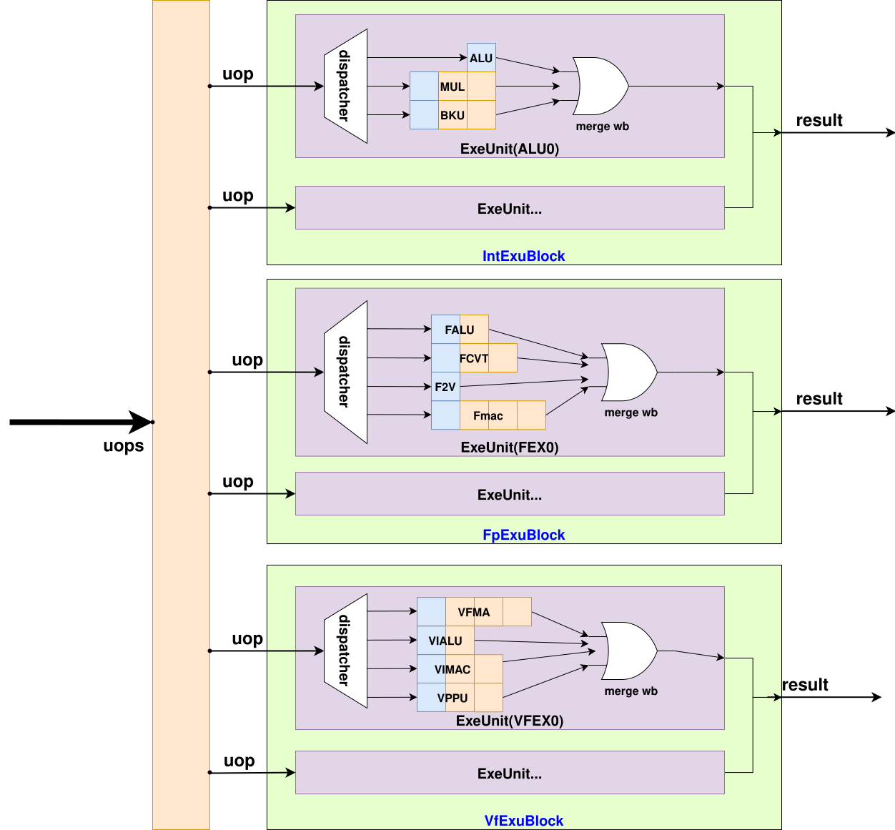

# ExuBlock

- 版本：V2R2A
- 状态：OK
- 日期：2026/10/13
- commit：[XSAI ee268923](https://github.com/OpenXiangShan/XSAI/tree/ee268923b7175d79a9d0183a0181a684ccec9487)

## 输入输出

`flush` 是一个带 valid 信号的 Redirect 输入

`in` 是按 issueBlock 和 每个 issueBlock 包含的 exu 对应的 ExuInput 输入。即 in(i)(j) 表示输入来源于第 i 个issueBlock 中的第 j 个exu。

`out` 是按 issueBlock 和 每个 issueBlock 包含的 exu 对应的 ExuOutput 输出。即 out(i)(j) 表示对应第 i 个issueBlock 中的第 j 个exu 的输出。

`csrio` 、 `csrin` 和 `csrToDecode` 只有当该 ExuBlock 中存在 `CSR` 时才存在。

类似地， `fenceio` 只有当该 ExuBlock 中存在 `fence` 时才存在。`frm` 只有当该 ExuBlock 中需要 `frm` 作为 src 时才存在。`vxrm` 只有当该 ExuBlock 中需要 `vxrm` 作为 src 时才存在。

`vtype` 、 `vlIsZero` 和 `vlIsVlmax` 只有当该 ExuBlock 中需要写 Vconfig 时才存在。

## 功能

ExuBlock 主要负责将外部模块传入的信号按照配置需求连接到各个 exu，并将 exu 的输出整理作为 ExuBlock 的输出。

## 设计规格

启用矩阵扩展时，Backend 包含 intExuBlock、fpExuBlock、vfExuBlock 和 mfExuBlock 四个执行块。矩阵访存执行资源仍位于 MemBlock。每个 ExuBlock 按 IssueBlock 配置包含若干 ExeUnit。

DefaultMatrixConfig 的 intExuBlock 中包含了 10 个 ExeUnit，IO 包括了 flush, in, out, csrio, csrin, csrToDecode, fenceio, frm, vtype, vlIsZero 和 vlIsVlmax，不包括 vxrm。

fpExuBlock 中包含了 5 个ExeUnit，IO 包括了 flush, in, out 和 frm，不包括 csrio, csrin, csrToDecode, fenceio, vxrm, vtype, vlIsZero 和 vlIsVlmax。

vfExuBlock 中包含了 5 个ExeUnit，IO 包括了 flush, in, out, frm, vxrm, vtype, vlIsZero 和 vlIsVlmax，不包括 csrio, csrin, csrToDecode 和 fenceio。

MfExuBlock 包含 MSET1、MEX0、MEX1 三个执行资源，分别用于规模读取、MMA 控制生成和 mzero 控制生成。其 mxrm、mfrm、msaten 输入按 needSrcMcsr 配置转发给需要矩阵 CSR 控制的 FU。输出包含普通 ROB 写回控制和可选的 amuCtrl。
