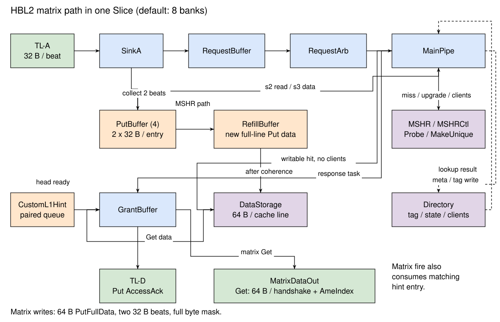

# 矩阵访存通路 HBL2

HBL2（High Bandwidth L2 Cache）是 XSAI 对 CoupledL2 的矩阵访存扩展。CUTE 通过 TileLink A 通道发送矩阵读写请求；每个 Slice 在通常的 TileLink D 返回之外提供一个 512 bit 的读数据接口，使一条 64 B 缓存行可以在一次握手中送入矩阵单元。

矩阵请求共用 CoupledL2 的目录、主流水线、MSHR 和 CHI 一致性机制。请求缺失、需要上层最新数据或需要撤销上层副本时，由 MSHR 完成必要的权限和数据交互。

## 术语说明

Table: HBL2 术语说明

| 名称 | 描述 |
| --- | --- |
| Slice / Bank | 按缓存行地址低位划分的 L2 缓存分片 |
| MatrixDataOut | 每个 Slice 独立的矩阵读数据返回接口 |
| ameIndex | 矩阵侧请求索引，用于匹配返回数据或写响应 |
| ameChannel | 矩阵侧数据通道号 |
| PutBuffer | 收集矩阵 PutFullData 的两个输入 beat |
| RefillBuffer | 以 MSHR 编号寻址的整行缓冲，保存下游回填或等待写入的 Put 数据 |
| ReleaseBuffer | 保存待释放的旧缓存行或上层 Probe 返回的数据 |

## 设计规格

Table: DefaultMatrixConfig 的 HBL2 参数

| 参数 | 配置 |
| --- | --- |
| Slice 数 | 8 |
| 每 Slice 组数、路数 | 512 组、8 路 |
| 每 Slice 容量 | 256 KiB |
| 总容量 | 2 MiB |
| 缓存行大小 | 64 B |
| A / D 通道数据 beat | 32 B |
| 矩阵读数据返回 | 每 Slice 512 bit，一次握手一行 |
| PutBuffer | 每 Slice 4 项，每项一行 |
| MSHR | 每 Slice 16 项，A 通道至多占用 15 项 |
| DataStorage MCP2 | 关闭 |
| 矩阵引导预取 | 默认关闭，使用独立配置开启 |

总容量由组数、路数、行大小和 Slice 数相乘得到，具体参数组合见 [CoupledL2 设计规格](CoupledL2.md)。8 个 Slice 的矩阵读返回接口聚合宽度为 512 B/cycle；矩阵写输入为每 Slice 32 B/beat，聚合输入宽度为 256 B/cycle。这些值描述持续握手且无冲突时的接口上限，实际吞吐受到 bank 分布、DataStorage 访问、队列占用和一致性事务的共同约束。

## 总体设计

### 整体框图

{#fig:xsai-hbl2}

矩阵请求经 SinkA、RequestBuffer 和 RequestArb 进入 MainPipe。控制任务与数据采用不同的保存位置：Put 的输入数据先进入 PutBuffer；需要等待一致性操作时，再转入以 MSHR 编号寻址的 RefillBuffer。任务只携带缓冲索引和请求元数据。

MainPipe 完成处理后，将上游响应交给 GrantBuffer。矩阵读响应从 MatrixDataOut 返回；矩阵写响应使用普通 D 通道。两个返回通路共用响应队列，并通过 CustomL1Hint 维持与提前唤醒信息的配对顺序。

### 请求与响应标识

Table: 矩阵请求的标识传递

| A 通道字段 | 内部保存 | 最终用途 |
| --- | --- | --- |
| source | sourceId | 普通 D 通道响应的 source |
| MatrixKey | matrixTask | bit 0 标识矩阵请求，选择矩阵读返回通路 |
| AmeIndexKey | ameIndex | MatrixDataOut.sourceId 或写响应的 AmeIndex |
| AmeChannelKey | ameChannel | MatrixDataOut.channel |
| MatrixPrefetchTagKey | matrixPrefetchTag | 可选矩阵引导预取训练 |

TileLink 的 source 与矩阵侧索引是两个独立标识。MatrixDataOut 的 sourceId 宽度为 64 bit，内容为 ameIndex；data 为一条 DSBlock；channel 取 4 bit ameChannel 的低 3 bit。接口通过 valid/ready 完成握手，接收端未就绪时，整行数据和标识保留在响应队头。

## 功能描述

### 矩阵 Get

1. SinkA 接收 Get 并保存矩阵标识，RequestBuffer 检查与流水线、MSHR 的冲突。
2. 请求进入主流水线并查询目录。命中且无需 Probe 时读取 DataStorage；Get 命中不需要更新目录。
3. 若命中 TRUNK 且上层持有该行，分配 MSHR，通过 Probe toB 获取最新副本。若缺失，分配 MSHR 向下发送 ReadNotSharedDirty，等待数据和权限回复，并按正常替换流程回填。
4. 返回任务保留 matrixTask、ameIndex 和 ameChannel，响应类型为 AccessAckData。GrantBuffer 将整行数据从 MatrixDataOut 一次发出。

矩阵 Get 根据目录状态和上层副本决定数据来源及 Probe 操作，详细状态与数据源见 [MSHR](MSHR.md)。

### 矩阵 PutFullData

矩阵 Put 支持完整缓存行、全字节 mask 的 PutFullData，MatrixKey 必须为 `2'b01`。请求包含两个 32 B beat；首 beat 分配并锁定 PutBuffer 项，最后一个 beat 完成整行数据收集，同时产生携带 bufIdx 的内部任务。

MainPipe 在 s2 读取 PutBuffer，在 s3 根据目录结果选择处理方式：

- 命中可写状态且无上层 client：直接写入 DataStorage，更新为 dirty、TIP、clients 为 0，安排 AccessAck。
- 命中 BRANCH：分配 MSHR，向下发送 MakeUnique 获取写权限。
- 命中且有上层 client：分配 MSHR，Probe toN 撤销上层副本；需要升级权限时同时安排 MakeUnique。
- 缺失：分配 MSHR，获得 MakeUnique 的 Comp 回复后查询替换路，按需释放旧行并写入新数据。

需要 MSHR 时，Put 的新数据从 PutBuffer 转入 RefillBuffer，等待必要的一致性响应。回填任务将 `useProbeData` 置为 false，选用 RefillBuffer 中的新数据。MakeUnique 返回写权限，Probe 和替换任务完成上层副本撤销及旧行释放。

Put 响应为普通 D 通道 AccessAck，source 对应 TileLink source，AmeIndex 对应矩阵侧索引。PutBuffer 在数据移交主流水线时释放，MSHR 在全部 Schedule / Wait 项完成后释放。具体数据流见 [PutBuffer](PutBuffer.md) 和 [请求仲裁器与主流水线](ReqArb_MainPipe.md)。

### 返回顺序与背压

普通 D 通道含数据响应分成两个 beat 发送。若第二个 beat 仍暂存在 GrantBuffer 中，它优先于新的矩阵响应；矩阵读数据还需要等待自身位于响应队头。

CustomL1Hint 为矩阵 AccessAckData 保存 isMatrixData 项。该项位于 Hint 队头时，Slice 才允许 MatrixDataOut 发送；矩阵数据握手同步释放该 Hint 项。矩阵项不向 L1 发出普通 Hint，也不占普通 D 通道的两个数据 beat。接收端背压会保留矩阵响应，并最终通过响应队列容量检查阻塞后续主流水线请求。详细规则见 [GrantBuffer](upstream/GrantBuffer.md)。

矩阵引导预取的配置、地址生成、调度和队列行为见 [可选矩阵引导预取](MatrixPrefetch.md)。
