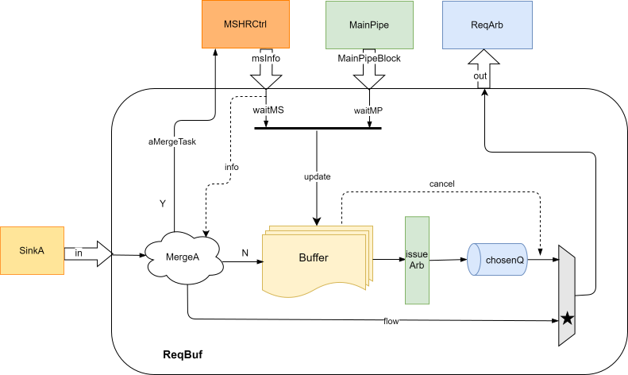

# A 通道请求缓冲 RequestBuffer

## 功能描述
- Request Buffer用来缓冲那些暂时需要阻塞的 A 通道请求，同时让满足释放条件/不需要阻塞的 A 通道请求先进入主流水线。
- 矩阵 Get 与 PutFullData 和普通 A 通道请求使用相同的冲突检查。Put 项只保存 TaskBundle 及其 `bufIdx`，整行写数据保留在 PutBuffer，直至任务进入主流水线。
- Request Buffer可以防止需要阻塞的 A 请求堵住流水线入口，从而避免对后续请求的影响，提高了缓存的处理效率。
- 如果有新到达的 Acquire 与 MSHR 中正在处理的预取请求地址相同，则可以进行请求融合，将 Acquire 的信息直接传到对应 MSHR 中，让 MSHR 处理完成后同时回复 L1 Acquire，从而加快了 Acquire 的处理流程，并减少了对 ReqBuf 和 MSHR 的占用。

### 特性1： 请求融合
当 RequestBuffer 接收到的 Acquire 请求和某一项 MSHR 中的预取请求有相同地址时，RequestBuffer 会将合并请求（aMergeTask）发送到相应的 MSHR entry，该项 MSHR 会被标注mergeA并更新MSHR的相关域。

可融合的需求请求仅包括 AcquireBlock / AcquirePerm。矩阵 Get 虽然会参与同地址晚到预取的统计，但不会生成 `mergeA`，仍需按照通常的请求冲突条件等待后续处理。

### 特性2：请求接收条件
RequestBuffer 入口的请求在哪些情况下允许被接收：
- RequestBuffer 没有满
- RequestBuffer 满了，但是 Acquire 请求可以和前面的预取请求融合
- RequestBuffer 满了，但是该请求是预取请求，并且已经前面已经有一条 Acquire/Prefetch 请求正在被 MSHR 处理

预取请求还受到 MSHR 占用门控：当流水线与 MSHR 的有效任务数达到 `mshrsAll - 3` 的阈值时，新 Hint 暂停进入。已经存在同地址请求的重复预取可以被接收并丢弃，不需要另行占用缓冲项。该门控不用于阻塞矩阵 Get / PutFullData 需求请求。

### 特性3：ReqestBuffer的分配
哪些请求会分配 RequestBuffer：
- RequestBuffer 没有满
- 不能直接 flow 进入流水线（即和 MainPipe或者某项 MSHR 地址冲突）或者 chosenQ 也准备发射
- 不能做请求融合
  
### 特性4：RequestBuffer项中的域
- Rdy：是否准备好被发射/出队
- Task：请求本身的信息
- WaitMP：被 MainPipe 哪几级流水线阻塞
- WaitMS：被哪几项 MSHR 阻塞

### 特性5：RequestBuffer如何更新和发射
- WaitMP(4bit)：因为 MainPipe是非阻塞流水线，所以 waitMP 每周期会右移一位，同时每拍会检查 s1 有无新的地址冲突的请求
  [3] s1, same set conflict
  [2] s2, same set conflict
  [1] s3, same set conflict
  [0] reserved
- WaitMS(16bit)：MSHR 被释放的前一拍会将 waitMS 相应的 bit 复位；同时有新的 MSHR 项被分配时会检查有无地址冲突(same set and tag)，如果有需要将 waitMS 相应 bit 置位
  onehot编码每个bit代表一个MSHR
- noFreeWay: 由于相同set有可能产生替换，所以[MSHR中same set的数目 + 流水线上S2/S3的same set的数目 >= l2 way 时，表示现在相同set的全部way都有可能被替换。这时就阻塞住RequestBuf进入流水线。
  s2 + s3 + MSHR >= ways(L2) 
- Rdy条件：在满足下面所有条件时，rdy为高表示可以被发射到流水线上进入RequestArbiter
  waitMP + waitMS 全部被清零
  noFreeway为低
  流水线s1级即将进入流水线的A/B通道请求没有 set 冲突

## 整体框图

