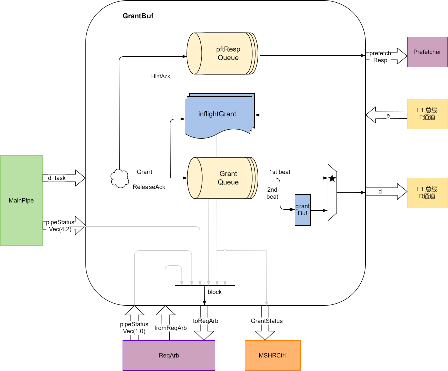

# GrantBuffer

## 基本功能

GrantBuffer 接收 MainPipe 输出的响应任务与整行数据，根据响应类型安排返回通路：

- HintAck：需要回复预取器时，进入 10 项的 pftRespQueue，按 FIFO 顺序返回。
- Grant、GrantData、AccessAck、AccessAckData、ReleaseAck 和 CBOAck：进入 grantQueue。任务队列与两个数据 beat 队列同步入队，默认各为 16 项。
- 矩阵 AccessAckData：和其他上游响应共用 grantQueue，在队头通过独立的 MatrixDataOut 接口返回整行数据。
- 融合请求（`mergeA`）：同时处理原预取响应和合并后的 Acquire 响应。

Grant / GrantData 还会分配 inflightGrant 项，记录已安排返回、尚未收到 E 通道 GrantAck 的缓存行地址。收到对应 GrantAck 后清除该项。Get / Put 的 AccessAckData / AccessAck 不需要等待 GrantAck。

### 特性 1：流水线入口反压

GrantBuffer 根据主流水线中可能产生响应的任务、grantQueue 占用、inflightGrant 占用，以及 pftRespQueue 占用，向 RequestArb 提供入口阻塞信号。已经进入主流水线的任务不能在输出端等待队列空位，因此需要在入口预留资源。

以 `N = mshrsAll` 表示响应任务队列和 inflightGrant 的项数，默认 N 为 16。容量检查使用以下资源统计：

Table: GrantBuffer 的资源统计

| 资源 | 当前占用 | 流水线中计入的任务 | 普通请求阻塞阈值 | MSHR 任务阻塞阈值 |
| --- | --- | --- | --- | --- |
| 响应任务队列 | grantQueue 项数 | 来自 A / C 通道的任务 | 总数 ≥ N | 总数 ≥ N − 1 |
| 等待 GrantAck 的资源 | inflightGrant 有效项数 | 来自 A 通道的任务 | 总数 ≥ N | 总数 ≥ N − 1 |
| 预取响应队列 | pftRespQueue 项数 | 来自 A 通道的任务 | 总数 ≥ 10 | 总数 ≥ 9 |

流水线统计不计入 s1，并通过更保守的阈值保留入口空间。计入 A 通道任务不代表每条任务最终都需要 GrantAck，而是入口处对可能使用资源的任务进行保守估计。

A 通道在任意一种资源不足时被阻塞；C 通道在响应任务队列资源不足时被阻塞；MSHR 任务在任意一种对应资源不足时被阻塞。对于 B 通道，只要存在同地址的 inflightGrant 项，就需要等待 GrantAck 完成，避免 Probe 越过尚未完成的 Grant。

矩阵响应虽然不占普通 D 通道的数据 beat，仍占用响应队列。矩阵接口长时间未就绪时，队列占用会通过上述入口检查反压后续请求。

### 特性 2：普通 D 通道数据宽度

没有数据的 Grant、AccessAck、ReleaseAck 和 CBOAck 只发送一个 D 通道 beat。普通 GrantData / AccessAckData 包含两个 32 B beat：第一个 beat 在 grantQueue 出队时发送，第二个 beat 暂存在 grantBuf 中，随后优先发送。只有暂存的 beat 完成握手后，才可取下一项响应。

需要关键字优先返回时，按照任务的 `isKeyword` 标记选择先发送的数据 beat，另一个 beat 存入 grantBuf。任务队列和两个数据队列始终按相同顺序出队。

### 特性 3：矩阵数据返回

队头任务满足 `matrixTask && opcode == AccessAckData` 时，GrantBuffer 不生成普通 D 通道数据响应，而是从 MatrixDataOut 返回完整缓存行：

Table: MatrixDataOut 字段

| 字段 | 位宽 | 内容 |
| --- | --- | --- |
| sourceId | 64 bit | 任务的 ameIndex，供矩阵侧匹配请求 |
| channel | 3 bit | 矩阵数据通道号，来自任务 ameChannel 的低 3 bit |
| data | 512 bit | 两个 32 B beat 按原始行内顺序组成的 DSBlock |

矩阵接口采用 Decoupled 握手。ready 为 0 时，响应保留在队头；握手成功时，任务队列和两个数据队列一起出队。若 grantBuf 中还有普通 D 通道的第二个 beat，该 beat 优先，矩阵响应等待其发送完成。

矩阵 Put 的 AccessAck 仍通过普通 D 通道返回，其中 source 保留 TileLink 事务 source，user 中的 AmeIndex 携带矩阵索引。

### 特性 4：Hint 与响应配对

MainPipe 中的 CustomL1Hint 按响应顺序记录提前唤醒信息。普通 D 通道响应的 Hint 由 l1Hint 接口发送，用于 L1D 等待回填的 Load 提前唤醒。

矩阵 AccessAckData 在 Hint 队列中设置 `isMatrixData`，不发送普通 l1Hint。Slice 将 GrantBuffer 的矩阵数据 valid 与“Hint 队头为矩阵响应”的条件相与；同时将矩阵接口 ready 和该条件返回给 GrantBuffer。MatrixDataOut 握手后，同步弹出对应 Hint 项。

因此矩阵响应需要同时满足三个条件：它位于响应队头、普通 D 通道没有暂存的 beat、对应矩阵 Hint 已到队头。独立的数据接口不会绕过这一配对顺序，也不会将一拍整行返回当作普通两拍 D 数据响应处理。

## 整体框图

矩阵返回与 Hint 配对关系见 [矩阵访存通路 HBL2](../HBL2.md) 中的整体框图。
