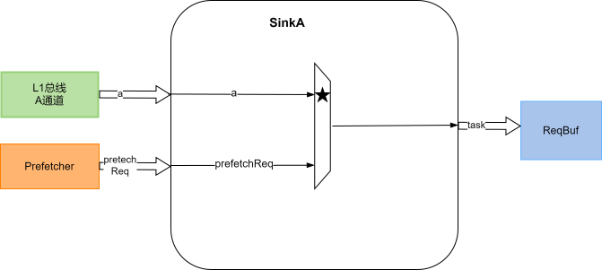

# SinkA

## 功能描述
SinkA 接收 TileLink A 通道请求和预取器请求，将请求转换为 TaskBundle 后发往 RequestBuffer。矩阵 Get 与 PutFullData 和普通 A 通道请求共用这一入口；Put 的写数据单独存入 [PutBuffer](../PutBuffer.md)，不随任务逐级传递。

### 特性 1：请求元数据

SinkA 从 A 通道提取地址、opcode、param、source、alias 等信息，并将其转为主流水线所需的 tag、set、块内偏移和任务属性。

矩阵请求额外携带以下信息：

Table: 矩阵 A 通道请求元数据

| 字段 | 内部任务字段 | 用途 |
| --- | --- | --- |
| MatrixKey | matrixTask | MatrixKey 的 bit 0 表示是否为矩阵请求 |
| AmeChannelKey | ameChannel | 矩阵数据返回通道号 |
| AmeIndexKey | ameIndex | 矩阵侧的请求索引 |
| MatrixPrefetchTagKey | matrixPrefetchTag | 可选矩阵引导预取的训练标记 |

`sourceId` 保留 TileLink 的事务 source，`ameIndex` 保留矩阵侧索引。矩阵 Get 的独立数据返回接口使用后者作为 sourceId，见 [GrantBuffer](GrantBuffer.md)。

### 特性 2：PutFullData 数据收集

矩阵 Put 仅支持完整的 64 B 缓存行：opcode 为 PutFullData，size 等于缓存行偏移位数，每个 beat 的字节 mask 全为 1，MatrixKey 为 `2'b01`。PutPartialData、子行 PutFullData 和带部分 mask 的写入均不支持。

A 通道每个 beat 为 32 B，因此整行 Put 包含两个 beat。首 beat 只写 PutBuffer，并锁定该行使用的缓冲项；最后一个 beat 在写 PutBuffer 的同时生成任务，将该项的索引写入 `bufIdx`。这样，RequestBuffer 只保存请求控制信息，而不需要保存整行写数据。

首 beat 能否接收由 PutBuffer 的 ready 决定；最后一个 beat 能否接收由 RequestBuffer 的 ready 决定。SinkA 在首 beat 握手后记录尚未完成的 Put，在最后一个 beat 握手后清除该状态。

### 特性 3：A 通道与预取仲裁

普通 A 通道任务和 Put 的最后一个 beat 优先于预取请求。Put 的首 beat 不占用 TaskBundle 输出端口，可以利用该周期发送一条已排队的预取请求；首 beat 已接收但最后一个 beat 尚未接收时，不再插入预取任务。

预取请求被转换为 Hint，param 根据所需权限选择 PREFETCH_READ 或 PREFETCH_WRITE。预取任务的 `matrixTask` 为 0；矩阵引导预取仍是送入缓存的读预取，不会通过矩阵数据返回接口向 CUTE 写入数据。

### 特性 4：阻塞

RequestBuffer 不能接收任务时，普通 A 请求、Put 的最后一个 beat 和预取请求通过 valid/ready 握手被阻塞。PutBuffer 没有空闲项时，新的 Put 首 beat 被阻塞。后续主流水线通过 `bufIdx` 读取 PutBuffer 后，该项可供新的 Put 使用。

## 整体框图

矩阵 Put 的缓冲与返回通路见 [矩阵访存通路 HBL2](../HBL2.md) 中的整体框图。
