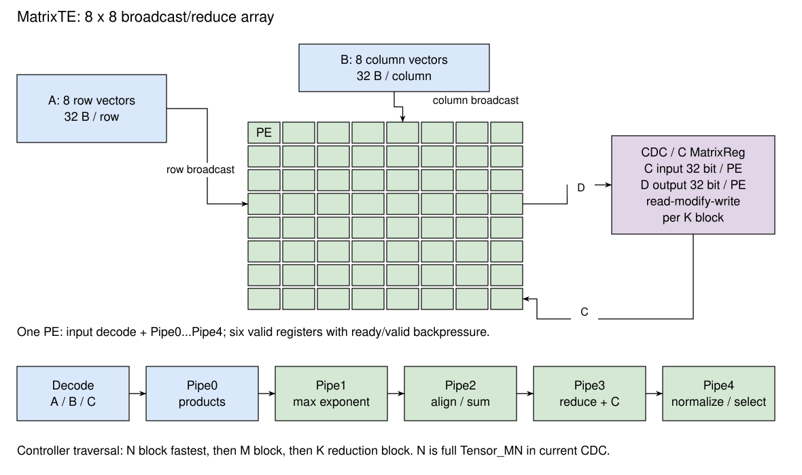

# 计算数据通路

## 设计规格

- 默认 MatrixTE 为 8×8 个 FReducePE。
- 每个 PE 输入 A、B 各 256 bit，以及一个 32 bit C；输出一个 32 bit D。
- 同一阵列行广播 A 向量，同一阵列列广播 B 向量。
- ADC、BDC、CDC 以同一遍历顺序供数，MTE 输入锁步握手。
- FReducePE 包含输入解码寄存和 MACPipe0 至 MACPipe4，共六个 valid 寄存段，支持逐级反压。
- 跨归约块的累加状态保存在 C SRAM，通过逐块读改写推进。

## 总体设计

{#fig:cute-compute}

[@fig:cute-compute] 中 ADC 一次读取八个 A 归约向量，BDC 一次读取八个 B 归约向量。PE `(i,j)` 使用 A 的第 i 个向量与 B 的第 j 个向量进行点积，并加上 C 块的 `(i,j)` 元素。64 个输出按行优先拼成 256 B 的 D 块，由 CDC 写回 C 寄存器。

A 沿阵列行广播、B 沿阵列列广播。各 PE 独立接收完整归约向量对，在自身流水线中计算点积和累加值，并输出对应的 D 元素。

## 计算形状限制 {#sec:cute-compute-shape}

设 `P = Matrix_MN = 8`，`R = ReduceWidthByte = 32 B`。TaskController 将 K 元素数按输入格式转换为字节数，再除以 R 得到 `Kreduce`。ADC/BDC 对 M 向上取整，CDC 先把 M 补到 P 的整数倍；CDC 要求 N 等于 `Tensor_MN = 128`。

默认完整形状使用 `N=128`、M 按 8 对齐且不超过 128、A/B 每行 K 字节数为 64。INT8/FP8 的 K 为 64，BF16 的 K 为 32；两者均对应两个 32 B 归约块。

A、B 必须选择不同的 AB 矩阵寄存器编号，即 `ms1 != ms2`。控制核 Mma 未检查这一条件，但 CUTE 的共享 AB 读端口对 ADC、BDC 同选一个寄存器存在冲突断言，见 [矩阵寄存器](MatrixReg.md)。

各维度的计数和访存行为如下：

- M 不按 8 对齐时，控制器仍读取、计算最后完整 8 行；补齐行的内容取决于 MatrixReg 原值和此前加载、清零操作。
- N 固定为 128；CDC 用断言检查该条件。
- K 字节数除以 32 得到整数归约块数；每个被计入的块均以完整 32 B 参与计算，块内没有有效元素掩码。
- AB loader 按每逻辑行两个 entry 的固定间距写入，ADC/BDC 按任务 `Kreduce` 计算行组地址。`Kreduce=2` 时二者一致；短 K 改变计算读地址，但保留 loader 写入间距。
- byte mask 控制加载更新的字节，未覆盖字节保留旧数据，并可能落入后续计算读取范围。

控制核检查指令形状的上界，CUTE 的遍历和地址生成按上述规则执行。软件分块时需要同时满足维度检查、MatrixReg 布局和完整块访问范围，并为计算读取的补齐区域准备数据。

## DataController 遍历与供数

### 地址和循环次序

令 `Mb=ceil(M/8)`、`Nb=N/8=16`，`kr` 为 32 B 归约块索引；M 为指令给出的行数，最后不足 8 行时仍处理完整行组。三个控制器按 N 块最快、再 M 块、最后 K 归约块的次序遍历：

```text
for kr in 0 .. Kreduce-1:
    for mb in 0 .. Mb-1:
        for nb in 0 .. Nb-1:
            Aentry = mb * Kreduce + kr
            Bentry = nb * Kreduce + kr
            Centry = mb * Nb + nb
            Dblock = dot(Ablock, Bblock) + Cblock
            C[Centry] = Dblock
```

A 的同一组八行归约向量在 N 块遍历中重复使用，B 的同一组八列向量在 M 块遍历中重复使用。每个归约块都对所有 M、N 块执行一次读 C、计算和写 C，然后才开始下一归约块。下一次累加重新从 C SRAM 读取前次结果。

一条完整任务向阵列提供 `Mb × Nb × Kreduce` 组输入，并写回相同数量的 D 块。执行时间由这些输入的握手间隔以及配置、SRAM 延迟、流水线填充排空共同决定。

### ready、valid 和 hold

MTE 以 PE(0,0) 的 A、B、C 输入 ready 汇总为 `ComputeGo`，并将该 ready 同时送给三条输入通路。所有 PE 按相同配置锁步执行，D 的 ready 由 CDC 广播，D 的 valid 由 PE(0,0) 代表。A、B 输入必须同周期握手。

`ComputeGo` 表示阵列当前可以接收下一组数据。ADC/BDC/CDC 用它协调 SRAM 读取；MatrixReg 一周期后返回时，如果阵列转为反压，DataController 将返回保存在单项 hold 寄存器。后续优先发送 hold 数据，只有实际 `fire` 才增加已消费输入计数。

ADC、BDC 在所有输入向量已经交给阵列后分别完成，TaskController 据此释放对应 AB 的读依赖。CDC 在接收并写回最后的 D 后报告整个 Compute 完成，TaskController 此时释放 Compute 资源和 C 的访问依赖。

### C 写回

MTE 输出按行优先排列的 8×8 D。CDC 将每行的八个元素作为一个 32 B entry 写到一个 C bank，所有 bank 使用相同 entry 地址，写掩码全一。写地址遍历 N 块、M 块，完成一轮后回到起点并推进 K 归约块计数。

默认 MMA 将 `Is_AfterOps_Tile` 等后处理控制位设为 false，计算结果按普通 C 布局写回。后续转置存储由独立的 CML store 任务执行。

## FReducePE 流水线

### 接口和输入解码

FReducePE 的 `opcode` 为 4 bit，输入 `AVector`、`BVector` 和 `CAdd` 使用 ready/valid。输入解码将不同格式统一为符号、10 bit 指数和有效数表示；整数区分 signed/unsigned，BF16 与 FP8 扩展到内部有效数宽度。TaskController 为 FP8 生成 E4M3×E4M3 和 E5M2×E5M2 两种计算类型，A、B 在每种类型中采用相同格式。

默认 256 bit 向量中，INT8/FP8 各包含 32 个元素，BF16 包含 16 个元素。同一个 PE 的向量字节宽度固定，归约元素数随输入格式改变。

Table: FReducePE 寄存阶段 {#tbl:cute-fpe-pipeline}

| 寄存阶段 | 主要操作 |
| --- | --- |
| 输入解码 | 将 A、B、C 转为内部类型，保存本组 opcode 和异常属性 |
| MACPipe0 | 形成乘积和乘积指数；INT8/FP8 使用两组乘积通路，开始最大指数比较 |
| MACPipe1 | 完成最大指数比较，生成各项对阶移位量，汇合 NaN、Inf、零等属性 |
| MACPipe2 | 浮点乘积扩展为 26 bit 后右移对阶；整数绕过浮点对阶；每组四项求和形成部分和 |
| MACPipe3 | 合并部分和和 C，形成归约结果；保留第二组结果供下一阶段合并 |
| MACPipe4 | 合并 INT8/FP8 两组；整数输出 32 bit 结果，浮点执行前导零计数、规格化、尾数截取和异常选择 |

每个寄存段保存 valid，并通过逐级 AllowIn 传播反压。当前级为空，或后级能够接收时，才允许装入下一组数据；阻塞时保留该级数据。单组数据依次经过六个寄存段，一条矩阵任务连续处理多组输入，并在最后结果写回后完成。

### 整数计算

整数输入按 opcode 进行有符号或无符号扩展，并进行归约乘加，输出 32 bit 结果。TaskController 忽略 MMA Bundle 中的 `sat`，FPE 使用固定整数数据通路，超出输出位宽的结果按该位宽截取。

### 浮点计算

浮点通路先比较乘积与 C 的指数，再对齐到共同指数进行分组归约。主要对阶数据宽度为 26 bit，右移时截去低位。规格化阶段通过前导零计数和移位截取 FP32 尾数，输出直接使用截取结果，未进行 G/R/S 驱动的 RNE 舍入修正。MMA Bundle 的 `rm` 字段在 TaskController 和 FPE 中未参与运算控制，结果由固定的分组、对阶和规格化次序决定。

规格化指数超过 127 时输出相应符号的 Inf；低于 −126 时继续右移有效数，形成非规格化结果；低于 −149 时有效数置零。这些移位同样采用截断。

异常选择具有固定输出：NaN 为 `0x7fc00000`，正、负 Inf 分别为 `0x7f800000`、`0xff800000`。E4M3 解码采用有限数和 NaN 的格式规则，全负零路径最终输出正零。FPE 输出接口携带 32 bit D 数据，浮点异常属性在流水线内部用于结果选择。

## 计算类型配置

DefaultMatrixConfig 启用 INT8→INT32、FP8→FP32、BF16→FP32。FP16、TF32、MXFP8、MXFP4、NVFP4 等 FPE 路径由静态配置开关决定是否实例化，在该配置中关闭。

块缩放输入由 Scale MatrixReg、Scale loader 和 Scale controller 提供。当前 TaskController 将 ASL、BSL、ASC、BSC 的任务 valid 固定为 false，默认配置关闭这组供数通路。

默认顶层由 MatrixTE 执行乘加，CDC 直接写回 C SRAM，未实例化 AfterOps、FakeVPU 或 VectorStreamInterface。Arith 类命令中的 mzero 由 loader 清零矩阵寄存器，其余 Arith 在调度器内按 `NopLike` 完成。

## 实现对应

本节对应 [MatrixTE](https://github.com/OpenXiangShan/CUTE/blob/d27b93d61c359478f4202f8f42cbfe82c830912a/src/main/scala/MatrixTE.scala)、[ADataController](https://github.com/OpenXiangShan/CUTE/blob/d27b93d61c359478f4202f8f42cbfe82c830912a/src/main/scala/ADataController.scala)、[BDataController](https://github.com/OpenXiangShan/CUTE/blob/d27b93d61c359478f4202f8f42cbfe82c830912a/src/main/scala/BDataController.scala)、[CDataController](https://github.com/OpenXiangShan/CUTE/blob/d27b93d61c359478f4202f8f42cbfe82c830912a/src/main/scala/CDataController.scala)、[FReducePE](https://github.com/OpenXiangShan/CUTEFPE/blob/7b40bf01ccfcc17ea7a54a610d9dceab0256c84a/fpe/src/main/scala/top/FReducePE.scala) 和 [MACPipes](https://github.com/OpenXiangShan/CUTEFPE/blob/7b40bf01ccfcc17ea7a54a610d9dceab0256c84a/fpe/src/main/scala/top/MACPipes.scala)。
