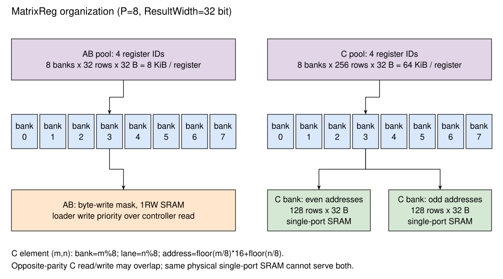

# 矩阵寄存器 MatrixReg

## 设计规格

CUTE 采用四个共享 AB MatrixReg 和四个 C MatrixReg。A、B 是矩阵操作中的角色，两个角色从同一组 AB 寄存器中选择输入；C 保存初始累加值和结果。TaskController 直接以矩阵寄存器编号维护任务依赖。

Table: 默认矩阵寄存器组织 {#tbl:cute-matrixreg-geometry}

| 属性 | AB MatrixReg | C MatrixReg |
| --- | --- | --- |
| 寄存器数量 | 4 | 4 |
| 单寄存器容量 | 128×64 B = 8 KiB | 128×128×4 B = 64 KiB |
| 逻辑 bank 数 | 8 | 8 |
| bank entry 宽度 | 32 B | 32 B，即 8 个 32 bit 元素 |
| 每逻辑 bank 深度 | 32 | 256 |
| 每逻辑 bank 的 SRAM | 一个 32 行单口 SRAM | 奇、偶地址各一个 128 行单口 SRAM |
| 读延迟 | 1 周期 | 1 周期 |
| loader 写掩码 | 按字节 | 按字节 |

{#fig:cute-matrixreg}

[@fig:cute-matrixreg] 中每个逻辑 bank 的 32 B 数据由 byte-wide way 组成，SRAM 的 waymask 作为字节写使能。部分写只更新掩码覆盖的字节，其它字节保留此前的寄存器内容；清零由独立的 ZeroTr 或 ZeroAcc 任务执行。

## AB 地址映射

令 `P = Matrix_MN`、`P = 8`，每个逻辑行的容量为 `Tensor_K = 64 B`，每个 bank entry 为 `R = ReduceWidthByte`、`R = 32 B`，因而每个逻辑行占两个 entry。A 在寄存器中保存 M 个归约向量；B 保存 N 个归约向量，供列方向广播。B 所需的转置由加载路径完成，BDC 本身读取已排好的归约向量。

对外层索引 `r` 和该行内的字节偏移 `q`，默认物理地址为：

```text
bank       = r % 8
entry      = floor(r / 8) * 2 + floor(q / 32)
byteInEntry = q % 32
```

因此 bank 0 依次存放逻辑行 0、8、16 等，每行占相邻两个 entry。bank 1 对应逻辑行 1、9、17 等，其余类推。一次整组读取从八个 bank 各取一个 32 B entry，得到八个归约向量，共 256 B。

Table: AB 默认布局示例 {#tbl:cute-ab-layout}

| 逻辑行 | bank | 前 32 B 的 entry | 后 32 B 的 entry |
| --- | --- | --- | --- |
| 0～7 | 0～7 | 0 | 1 |
| 8～15 | 0～7 | 2 | 3 |
| 120～127 | 0～7 | 30 | 31 |

ADC 选择其中一个 AB 寄存器，BDC 选择另一个。顶层不允许两个 DataController 同周期选择同一个 AB 寄存器，也不允许两个 loader 同周期写同一个 AB 寄存器。TaskController 的依赖和 FU 选择需要与这些端口约束共同满足。

## AB 读写控制

MemoryLoader 按 bank 提供地址、数据和字节掩码；DataController 提供八个 bank 的读地址。ABMatrixReg 使用写优先策略：存在 loader 写地址或写操作时，整组 DataController 读请求被阻挡。即使本周期只写一个 bank，也不允许其它 bank 继续完成本次整组读取。

没有写请求且 DataController 提出读请求时，`BankAddr.ready` 允许读取；SRAM 在下一周期返回数据，`Data.valid` 是读允许信号的打一拍结果。ABMatrixReg 内部不保存被下游拒收的读数据，这个保存责任由 ADC/BDC 的 hold 寄存器承担。

例如，周期 t 接受一次读地址，周期 t+1 返回八个 bank 的数据；如果 MTE 在 t+1 不能接收，DataController 保存该组数据，等待后续输入握手。供数间隔同时受 loader 写优先和 MTE 反压影响。

## C 地址映射

C 的每个 bank entry 包含同一矩阵行的八个相邻 N 元素。令矩阵坐标为 `(m,n)`，默认映射为：

```text
bank  = m % 8
entry = floor(m / 8) * 16 + floor(n / 8)
lane  = n % 8
```

其中 16 为 `Tensor_MN / Matrix_MN`。一个 entry 的 lane 0～7 分别保存 N 方向的八个元素；八个 bank 的同一 entry 合起来是一块 8×8 C 矩阵。MTE 的结果按行优先拼接，CDC 将每个输出行写到相应 bank。

Table: C 默认布局示例 {#tbl:cute-c-layout}

| 矩阵坐标范围 | bank | entry | lane |
| --- | --- | --- | --- |
| m=0～7，n=0～7 | m | 0 | n |
| m=0～7，n=8～15 | m | 1 | n−8 |
| m=8～15，n=0～7 | m−8 | 16 | n |
| m=120～127，n=120～127 | m−120 | 255 | n−120 |

M 方向行组的物理间距固定为 16 个 entry，CML 存储也按该物理间距读取。较小逻辑 N 的加载和存储仍使用这个固定布局；计算路径要求 N 等于 128，见 [计算形状限制](Compute.md#sec:cute-compute-shape)。

## C 的奇偶单口组织

每个 C 逻辑 bank 按 entry 地址最低位拆为 even、odd 两个物理 SRAM：

```text
physicalBank = entry % 2
physicalRow  = floor(entry / 2)
```

同周期读偶 entry、写奇 entry，或读奇 entry、写偶 entry，可以使用两个不同的 SRAM。每个物理 SRAM 只有一个访问端口；对同一奇偶 SRAM 同周期读写会触发冲突断言，访问时序需要满足这一端口约束。

CMatrixReg 接收来自 CDC、CML load、CML store 的请求类别。CDC 读取初始 C、写入 D；CML load 写 C；CML store 读 C。模块断言同周期不能存在两个读来源，也不能存在两个写来源。对同一个 C 寄存器的任务顺序由 TaskController 保证；不同 C 寄存器上的 load、compute、store 可以使用各自的存储体重叠。

请求类别被打一拍，用于选择下一拍 SRAM 返回数据的接收方。CDC 的计算写回使用全 entry 掩码；CML load 可使用部分字节掩码，尤其是转置加载时每次只更新一个 32 bit lane。

## 清零和部分更新

`ZeroTr` 通过 AML 逐 entry 将选定 AB 寄存器的所有 bank 写零；`ZeroAcc` 通过 CML load 逐 entry 将选定 C 寄存器写零。这两种任务不发外部存储请求，仍占用对应 loader，并在最后内部写入之后完成。

普通加载和转置加载只写有效数据所覆盖的字节，其余区域继续保存原内容。计算按完整归约块和行组读取，因此尾部补齐区域也需要预先准备有效值。MatrixReg 内部按字节更新，C store 则按完整外部 beat 写出，见 [矩阵加载与存储](MemoryLoader.md)。

## 实现对应

本节对应 [ABMatrixReg](https://github.com/OpenXiangShan/CUTE/blob/d27b93d61c359478f4202f8f42cbfe82c830912a/src/main/scala/ABMatrixReg.scala)、[CMatrixReg](https://github.com/OpenXiangShan/CUTE/blob/d27b93d61c359478f4202f8f42cbfe82c830912a/src/main/scala/CMatrixReg.scala)、[寄存器参数](https://github.com/OpenXiangShan/CUTE/blob/d27b93d61c359478f4202f8f42cbfe82c830912a/src/main/scala/CUTEParameters.scala) 和 [顶层寄存器端口选择](https://github.com/OpenXiangShan/CUTE/blob/d27b93d61c359478f4202f8f42cbfe82c830912a/src/main/scala/CUTETOP.scala)。
