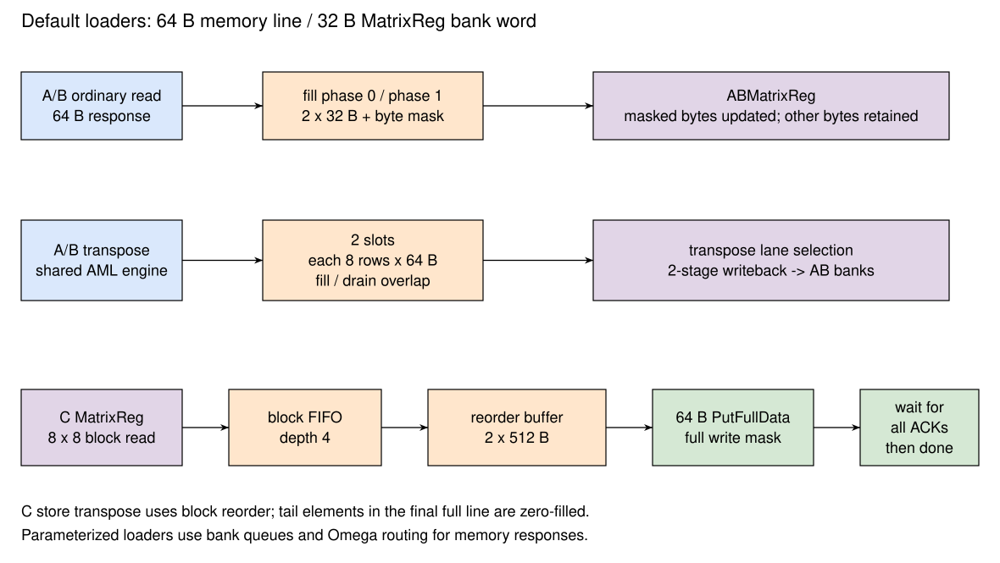

# 矩阵加载与存储 MemoryLoader

## 设计规格

MemoryLoader 将外部按行存放的数据搬入 MatrixReg，或将 C 寄存器结果写回外部存储器。默认外部数据宽度为 64 B，MatrixReg bank entry 为 32 B；一次外部响应通常需要拆成两次内部写入。

默认配置 `ALBLCLLCSL` 中，普通 A/B loader 和 C load/store 均采用 legacy 实现。A、B 转置加载统一交给 AML 封装中的 `TransposeLoadEngine`，BML 处理普通 B 加载。参数化通道实现作为另一种静态配置，见 [参数化 loader](#sec:cute-parameterized-loader)。

## 总体设计

{#fig:cute-loaders}

[@fig:cute-loaders] 中，普通 A/B 响应按事务标识恢复目标 bank 和 entry，经过响应缓冲写入 MatrixReg。转置路径先按源行收集数据，再将片段分发到多个 bank。C store 则先读取 8×8 结果块，经 FIFO 和两槽重排缓冲拼成 64 B 写请求，最后等待外部写应答。

## 任务配置与完成

TaskController 通过 `MicroTaskValid`、`MicroTaskReady` 启动 loader，通过 `MicroTaskEndValid`、`MicroTaskEndReady` 回收执行资源。CML load 和 store 分别具有任务 ready、valid 和完成信号，也分别保存目标 C 寄存器编号。

loader 启动后锁存地址、stride、矩阵尺寸、寄存器编号和相关模式。请求计数在外部请求 `fire` 时推进，响应计数在返回握手时推进，内部写入计数在填充阶段推进。load 在全部数据填入 MatrixReg 后完成；store 在全部数据发出且写应答收齐后完成。

## 普通 A/B 加载

### 地址生成

普通 A 加载的外层坐标为 M，普通 B 加载的外层坐标为 N；两者的内层都是已组织成连续字节的归约维。对外层行 `r`、该行的第 `b` 个外部 beat：

```text
memoryAddress = baseAddr + r * stride + b * 64
targetBank    = r % 8
targetEntry   = floor(r / 8) * 2 + b * 2
```

一次 64 B 响应拆为 `targetEntry` 与 `targetEntry+1` 两个 32 B entry。内部物理行间距的系数 2 由 AB 寄存器完整行容量决定，短 K 任务也使用这个固定间距。

MLSU 生成的 A 描述符为 `row=M, column=K`，B 描述符为 `row=K, column=N`。这些字段保存架构形状，TaskController 会按操作类别解释：普通 B 使用 N 个外层行，每行 K 个连续元素；转置 B 从 K 个源行、每行 N 个连续元素加载。A 转置同样将源行数改为 K、每行元素数改为 M。四种源布局及整寄存器 B 的对应关系见 [MLSU 源内存布局](../memblock/LSU/MLSU.md#tbl:MLSU-source-layout)。

普通 legacy loader 使用外部请求通道 0。请求按一组最多八个外层行交错产生，再推进外部 beat 和下一组行；每次请求仍只搬运一行中的一个 64 B beat。控制器可在此前请求未返回时继续发请求，受事务标识池和返回缓冲容量限制。

### 响应定位和填充

请求发出时，loader 以分配的 SourceID 为索引记录目标 bank、起始 entry 和是否尾 beat。响应返回时使用 SourceID 查表，恢复该请求对应的写入位置。响应数据进入 fill table，目标 bank 的队列保存对应 fill 项编号。

每个 bank 从自己的队列取待填充项，先写低 32 B，再写高 32 B。不同 bank 可以同时推进内部填充；某个 bank 的 fill 队列满会反压指向该 bank 的返回。最后一条内存响应也需要经过 fill 队列和两次内部写入，loader 才能完成任务。

尾 beat 记录的是有效字节数，loader 将其展开为前缀掩码，再拆为两个 32 B 写掩码。有效范围之外的 MatrixReg 字节保留原值；外部读仍覆盖完整 beat，因此源内存需要提供完整 beat 的可读空间。

### AB 清零

`ZeroTr` 使用 AML 的零加载模式，在所有 bank 上逐 entry 写入全零和全字节掩码。默认每个 bank 共 32 个 entry，整个选定 AB 寄存器都被清零，期间不产生外部请求。零加载与普通加载、转置加载共用 AML 的任务资源。

## A/B 转置加载

### 任务与资源

转置 A 和转置 B 均路由到 AML 的 `TransposeLoadEngine`。普通 B 加载使用 BML，可以与 AML 转置任务在不同 AB 寄存器上重叠；普通 A、A/B 转置和 ZeroTr 由 AML 串行执行。

转置引擎以源行和源列构成搬运范围，将源矩阵的列转换为 AB 寄存器的外层行。其默认外部 beat 为 64 B，元素格式为 e8、e16 或 e32，e4 会触发格式断言。输入基地址要求 64 B 对齐；多源行时 stride 也要求 64 B 对齐。源行数乘元素字节数最多为 `Tensor_K`，源列数最多为 `Tensor_MN`。零尺寸任务直接完成。

### 两槽收集与标签

引擎设置两个收集槽，每槽保存八个 512 bit 源行响应，共 512 B。槽先预留，再发出对应请求，分别维护 expected、issued、received 掩码。响应 SourceID 携带槽号和源行号，回数位置由标签恢复；乱序返回不会改变矩阵坐标。

物理响应 lane 按源行与通道分配规则接收数据。槽在 expected 掩码覆盖的响应全部到达后进入转置写回。两个槽分别收集和排出相邻块，槽满或写回阻塞时停止后续请求。

### 转置写回

填满槽后，通过固定连线从八个源行中选取相应元素，拼成目标 bank 的片段。写回有两个寄存级：第一级选择转置片段，第二级按固定 8 B 步长放置到目标 entry，并输出各 bank 地址、数据和字节掩码。

写回流水线接受反压，只有 writeback 握手才释放当前片段。最后一个内存响应到达后，剩余片段继续经过转置和写回流水线；最后一个片段写入后产生任务完成信号。AML 适配层将写回转为 AB 的逐 bank 字节写，未覆盖的字节继续保留原值。

## 默认 C 加载

### 普通加载

CML 的普通加载按 `baseAddr + m*stride + beat*64` 访问内存。默认 e32 格式中，每个响应包含同一源行的 16 个元素，拆为两个 32 B entry。目标 bank 为 `m%8`，entry 使用固定的 C 行组间距：

```text
entry = floor(m / 8) * 16 + beat * 2 + fillPhase
fillPhase = 0 or 1
```

尾字节用内部写掩码限制；没有写到的 C lane 保留旧值。CML load 与 store 具有独立状态机和独立目标寄存器，可以在不同 C 寄存器上重叠。二者共享配置 payload，TaskController 每周期选择并发送一个任务配置。

### 转置加载

默认 legacy CML 支持 e32 转置加载。源行中的 16 个元素分别成为转置矩阵的不同行；源行坐标决定目标 lane，源列坐标决定目标 bank 和 entry 行组。

一个 64 B 响应分两个 phase，每个 phase 处理八个元素，向八个 bank 各写一个 32 bit lane。每次只打开该 lane 的四字节掩码。目标 entry 由源列所在的 8 行组和源行所在的 8 列组形成，保持与普通 C 布局相同的固定物理行组间距。尾部有效性按元素限制，未覆盖 lane 不被清零。

### C 清零

`ZeroAcc` 通过 CML load 通路将选定 C 寄存器的所有 256 个 entry、所有 bank 全掩码写零，不访问外部存储器。清零不按当前小矩阵形状缩减范围。

TaskController 为 CML 选择普通加载或清零模式，`RepeatRowLoad` 控制位保持为 false；CML 中对应的重复行填充逻辑未启用。

## 默认 C 存储

### 读取与两槽重排

CML store 每次从八个 bank 读取同一 entry，获得一块 8×8×32 bit 数据，共 256 B。返回数据进入深度为 4 的块 FIFO。SRAM 读有一周期延迟，读请求的满阈值为在途返回预留一个队列位置。

重排缓冲设置两个槽。每槽保存八行，每行收集两个 32 B 片段，组成八条 64 B 请求，共 512 B。普通存储把相邻 N 块的同一行拼接；转置存储先在 8×8 块内交换行列，再按原 M 方向拼接。因此两种模式的块读取遍历不同：普通存储 N 块最快，转置存储 M 块最快。

两个槽分别跟踪填充和排出，允许一个槽发送请求时另一个槽继续收集 MatrixReg 返回。外部 ready 拉低时保留当前输出，相关槽不能提前复用。

### 地址与应答

普通存储的外层是 M，连续维是 N；转置存储的外层是 N，连续维是 M。每条请求的地址为外层行起点加连续维的字节偏移，stride 以字节计。读取 C 的物理 entry 始终使用 `Tensor_MN/Matrix_MN = 16` 的固定行组间距。

CML 保存 64 项写等待状态。请求成功发出后标记对应 SourceID 在途，收到写 ACK 后清除。全部数据发完时仍可能存在未应答写请求；只有这些应答全部收齐，store 才完成并允许依赖它的 Release 发射。

### 存储边界 {#sec:cute-store-boundary}

默认 C store 处理 e32 的 INT32/FP32 元素，数据布局和重排以 `ResultWidthByte=4` 为基础。MLS 描述符的 `widths` 参与地址与请求计数，但 store 的缓冲、拼接和尾部填零始终按 32 bit 元素执行。e8、e16、e4 描述符会改变计数而不改变数据格式，因此存储任务需要使用 e32。

默认 C store 发出完整 64 B `PutFullData`，掩码全一。连续维最后一条请求中超出逻辑范围的元素填零，并随有效元素一起写入外部存储器；该请求覆盖范围内的全部字节都会更新。

例如 e32 的一行只有八个待存元素，占 32 B，发出的最后一条请求仍覆盖 64 B；后半部分按尾部规则写零。软件必须为输出保留完整写 beat 覆盖的空间，特别是转置存储中 M 方向不足 16 个元素的最后一组。

Store 派发统一使用 CML 和 `ms` 的低两位选择 C 寄存器，因此有效的存储类别为 C。MLSU 形成的 A/B store 描述符也会进入这一派发分支，实际读取相同低两位编号的 C 寄存器。AB 寄存器只有加载写入和计算读取端口，当前 A/B store 不执行架构定义的 AB 写回。

## 参数化 loader {#sec:cute-parameterized-loader}

`LoaderBridgeChannelConfig` 分别选择 A、B、C load、C store 的实现：`L` 使用 legacy，`1`、`2`、`4`、`8` 使用相应响应宽度的参数化模块。C load 和 C store 共用模块，二者必须同为 legacy 或同为参数化实现；参数化模块内部可以为 load 和 store 选择不同响应宽度。

Table: 参数化数据通路与默认路径的区别 {#tbl:cute-parameterized-loaders}

| 模块 | 机制 | 当前功能边界 |
| --- | --- | --- |
| `MultiChannelsABMemLoader` | 每 bank 独立行/beat 计数、请求 FIFO 和返回填充队列；SourceID 编码 tail、bank、entry | 普通加载；转置仍由 AML wrapper 的独立引擎承接 |
| `ResponseChannelBridge` | 按 SourceID 的 bank 字段，经 Omega 路由到 bank-group 队列 | 路由竞争和队列满会产生反压 |
| 参数化 C load | 每 bank 独立计数和 fill 队列 | 使用普通加载布局；转置标志未参与锁存和地址生成 |
| 参数化 C store | 每 bank 深度 4 的读返回队列，两次 32 B collector 拼成 64 B | 普通路径；转置地址状态和块内转置尚不完整 |
| 参数化 C store ACK | 默认直接统计各 lane ACK 数；也可按 bank 统计 | 全部预计 ACK 到达后完成 |

参数化 AB 返回队列默认深度为 2，C load fill 队列默认深度为 2，response bridge 每 bank 队列默认深度为 8。Omega 网络由多层 2×2 组合交换及 perfect shuffle 构成，响应在网络输出处进入 bank-group 队列；路径竞争或队列满时向输入传播反压。

参数化 C store 的 `transpose_scp_addr` 固定为零，collector 按 bank 原顺序拼接两个 32 B 返回；转置模式目前缺少逐块地址推进和块内行列交换，需要使用 legacy CML 完成转置加载或存储。参数化 store 同样发出全掩码 64 B 写请求，其 collector 按原数据拼接，尾部行为由该模块的计数和数据选择逻辑决定。

## 实现对应

本节对应 [TaskController 形状解释](https://github.com/OpenXiangShan/CUTE/blob/d27b93d61c359478f4202f8f42cbfe82c830912a/src/main/scala/TaskController.scala)、[AMemoryLoader](https://github.com/OpenXiangShan/CUTE/blob/d27b93d61c359478f4202f8f42cbfe82c830912a/src/main/scala/AMemoryLoader.scala)、[BMemoryLoader](https://github.com/OpenXiangShan/CUTE/blob/d27b93d61c359478f4202f8f42cbfe82c830912a/src/main/scala/BMemoryLoader.scala)、[TransposeLoadEngine](https://github.com/OpenXiangShan/CUTE/blob/d27b93d61c359478f4202f8f42cbfe82c830912a/src/main/scala/TransposeLoadEngine.scala)、[CMemoryLoader](https://github.com/OpenXiangShan/CUTE/blob/d27b93d61c359478f4202f8f42cbfe82c830912a/src/main/scala/CMemoryLoader.scala) 和 [MultiChannelsCML](https://github.com/OpenXiangShan/CUTE/blob/d27b93d61c359478f4202f8f42cbfe82c830912a/src/main/scala/MultiChannelsCML.scala)。
