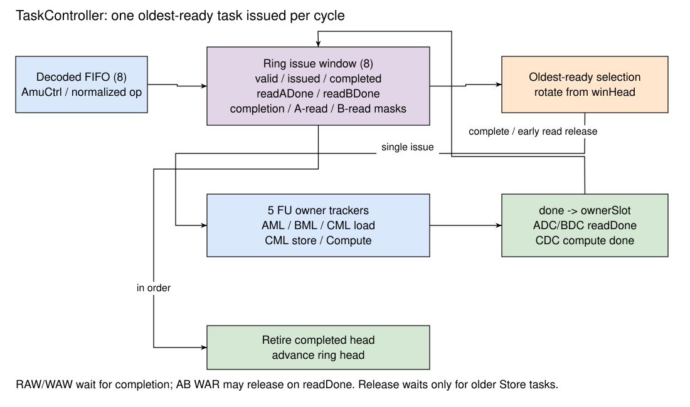

# 任务控制 TaskController

## 设计规格

- 命令入口采用 `AmuCtrlIO` 的 `ready/valid` 握手。
- decoded FIFO 与环形发射窗口默认各 8 项；窗口可静态配置为 4、8、16 项。
- 每周期至多发射一个就绪任务，采用最老就绪优先。
- 为 AML、BML、CML load、Compute、CML store 分别保存执行资源占用和拥有者。
- 通过完成依赖、A 读完成依赖、B 读完成依赖维护矩阵寄存器顺序。
- 任务可以乱序发射和完成，每周期至多从窗口头退休一个任务。

## 总体设计

{#fig:cute-task-window}

[@fig:cute-task-window] 中的 decoded FIFO 保存命令和静态读写集合；发射窗口保存任务状态以及对更老任务的依赖。任务发射后，对应 FU tracker 以 `ownerSlot` 记录其窗口槽号。模块完成时按拥有者更新原槽；退休检查 `winHead`，按入窗顺序释放槽。

窗口退休释放 CUTE 的任务记录。控制核另行维护矩阵指令的执行和 ROB 提交状态，并通过 Release 完成脉冲更新同步寄存器；两侧状态分别由各自的控制逻辑推进。

## 命令入口与译码

`AmuCtrlIO` 包含 2 bit `op` 和 150 bit `data`。`op` 区分 MMA、MLS、Release、Arith，`data` 按操作类别解释为不同 Bundle。启用 Difftest 时还携带 `pc` 和 `coreid`。入口 `fire` 将命令写入 decoded FIFO；前级背压来自 FIFO 可用空间。

MMA 保存 `ms1`、`ms2`、`md`、`mtilem`、`mtilen`、`mtilek` 及格式编码。MLS 保存寄存器编号、load/store、A/B/C 类别、转置标志、48 bit 基地址、48 bit stride、行列数和元素宽度。地址与 stride 的单位为字节，行列数为元素数。

译码为每条命令生成最多三个读寄存器和一个写寄存器的静态集合。MMA 读取两个 AB 和目的 C，并写目的 C；load 写目标寄存器；store 读目标寄存器；mzero 写目标寄存器。Arith 当前只识别 mzero 类操作，其余 Arith 归入无读写集合的 `NopLike`。

Table: 任务分类和执行资源 {#tbl:cute-task-fu}

| 任务 | 功能 | 发射所需资源 |
| --- | --- | --- |
| `LoadA` | 普通或转置 A 加载 | AML 空闲且 ready |
| `LoadB`，普通 | 普通 B 加载 | BML 空闲且 ready |
| `LoadB`，转置 | 经共享转置引擎加载 B | AML 空闲且 ready |
| `LoadC` | C 初始值加载 | CML load 空闲且 ready |
| `Compute` | 矩阵乘加 | Compute 空闲，ADC、BDC、CDC 都 ready |
| `Store` | 经 CML 写回结果 | CML store 空闲且 ready |
| `ZeroAcc` | 清零 C 寄存器 | CML load 空闲且 ready |
| `ZeroTr` | 清零 AB 寄存器 | AML 空闲且 ready |
| `Release` | 更新选定同步寄存器的完成状态 | 调度器内执行 |
| `NopLike` | 无矩阵数据操作 | 调度器内执行 |

加载类别 `isA`、`isB`、`isacc` 必须 one-hot。CUTE 内部的 AB 和 C 编号各取寄存器编号的低两位，类别由命令语义决定。Store 发射统一配置 CML，由 CML 读取选定的 C 寄存器；依赖识别仍按命令的寄存器类别建立读集合。Store 的类别要求见 [存储边界](MemoryLoader.md#sec:cute-store-boundary)。

## 发射窗口

窗口用 `winHead`、`winTail`、`winCount` 维护环形年龄顺序。每槽的主要状态如下。

Table: 发射窗口槽状态 {#tbl:cute-window-state}

| 字段 | 含义 |
| --- | --- |
| `valid` | 槽保存一个存活任务 |
| `issued` | 任务已经发给执行模块或在调度器内执行 |
| `completed` | 任务的数据操作已完成 |
| `readADone`、`readBDone` | Compute 已将全部 A/B 操作数交给阵列，不再读对应 AB 寄存器 |
| `waitCompleteMask` | 需要等待完成的更老窗口槽集合 |
| `waitReadAMask`、`waitReadBMask` | 需要等待 A/B 读完成的更老 Compute 槽集合 |
| `opKind`、`entry` | 任务类别、原始命令和静态读写集合 |
| `seqId` | 16 bit 任务序号，用于关联调试事件 |
| `fifoIdx` | 分类别维护的调试索引 |

decoded FIFO 头可以在窗口未满时入窗；窗口已满时，如果同周期窗口头退休，也可以复用刚释放的槽。依赖建立时排除该周期退休的任务，避免将新任务关联到已释放的槽号。

## 依赖建立与解除

新任务入窗时，仅与严格更老且仍存活的槽比较读写集合。依赖在入窗时建立，随后通过老任务的状态位判断是否已经满足；老任务退休时广播槽号，清除所有等待掩码中的对应位。窗口不进行矩阵寄存器重命名。

Table: 矩阵寄存器依赖规则 {#tbl:cute-task-dependencies}

| 更老任务与新任务的关系 | 等待条件 |
| --- | --- |
| 老任务写 AB，新任务读或写同一 AB | 老任务 `completed` |
| 老任务读 AB，新任务写同一 AB，且老任务为 Compute 的 A 输入 | 老任务 `readADone` |
| 老任务读 AB，新任务写同一 AB，且老任务为 Compute 的 B 输入 | 老任务 `readBDone` |
| 老任务以其它方式读 AB，新任务写同一 AB | 老任务 `completed` |
| 对 C 的 RAW、WAW、WAR | 老任务 `completed` |
| 新任务为 Release | 所有更老 Store 的 `completed` |

Compute 对 C 同时读写，因此后续读取、覆盖同一 C 的任务必须等待 Compute 完成。A、B 读完成独立维护：若后续加载只覆盖 A 所在 AB 寄存器，只需要相应的 A 读完成。依赖建图分别记录 A、B 读完成；实际计算仍要求两个输入选择不同的 AB 寄存器，见 [矩阵寄存器](MatrixReg.md)。

例如，依次进入窗口的任务为 `LoadA tr0`、`LoadB tr1`、`Compute tr0,tr1,acc0`、`LoadA tr0`、`Store acc0`。Compute 等待前两个加载完成；第二条 `LoadA tr0` 等待 Compute 的 `readADone`，可以在 C 结果写回完成前开始；Store 等待 Compute 的整体完成。A 的全部操作数被阵列接收后，后续加载即可覆盖 tr0，同时 PE 继续处理在途数据并写回 C。

## 最老就绪发射

每个未发射槽分别计算依赖就绪与资源就绪。依赖就绪要求三个等待掩码中没有尚未满足的位；资源就绪由 [@tbl:cute-task-fu] 中的模块占用和 ready 决定。

就绪向量按 `winHead` 旋转为年龄顺序，使用优先编码器选择最老就绪项，再映射回实际槽号。因此较老但等待数据的任务不阻挡更年轻的独立任务发射，但总发射宽度仍为一。发射选择使用周期开始时的窗口状态：新入窗的任务和该周期刚收到完成信号才被解除依赖的任务，不走同周期发射旁路。

发射一个 Compute 时，TaskController 同时为 ADC、BDC、CDC 配置形状和寄存器编号，并为 MTE 配置计算类型。M、N 保持元素计数；K 转为字节数，再除以 `ReduceWidthByte`，作为计算归约块数。loader 使用的外部 beat 计数按 64 B 向上取整，与计算归约块计数不同。

## 完成与退休时序

五个 FU tracker 分别维护 `busy` 和 `ownerSlot`。任务发射占用相应 tracker；完成接口采用 `MicroTaskEndValid && MicroTaskEndReady`，其中 EndReady 仅在存在合法拥有者时拉高。不存在拥有者的完成信号属于接口错误。

AML/BML/CML load/CML store 完成时，设置拥有者槽的 `completed` 并释放 tracker。Compute 的 ADC、BDC 完成分别设置 `readADone`、`readBDone`；CDC 在所有结果写回后完成，设置 `completed` 并释放 Compute tracker。CDC 完成不得早于 A、B 读完成。

窗口头已经完成时可以退休；如果窗口头在本周期通过 FU 完成握手，退休逻辑也允许使用该完成结果直接退休。每周期只退休一项，年轻任务即使已经完成，也需要等前面的任务依次释放。退休同时可以接收新任务，维持窗口容量。

## Release 的同步语义 {#sec:cute-release}

Release 入窗时建立对所有更老 Store 的完成依赖。Release 发射时，在 `mrelease` 上产生一个 Valid 脉冲，将指定 `msyncRd` 位置为真，并将自身标记为已完成。此接口没有 ready，接收端按脉冲更新同步状态。

所有更老 Store 完成后，Release 满足依赖就绪条件，参与最老就绪发射选择；此时无关的老 Load 或 Compute 可以继续执行。若窗口头仍有未完成任务，Release 产生脉冲后保留在窗口中，直到按序退休。若某个老 Store 依赖前面的 Compute，则这条依赖链也会延后 Release。

Release 的完成条件覆盖此前 Store 的 CML 写应答。控制核的 `mrelease` 完成返回会使 Fence 更新对应同步计数器；`macquire` 等待目标计数器达到指定值。若需要排空标量存储缓冲，`mfence` 单独请求 SBuffer flush 并等待 `sbIsEmpty`，其完成条件与 CUTE Release 分开。详见[矩阵同步](../backend/FunctionUnit/IntFunctionUnit.md#sec:matrix-sync)。

## 实现对应

本节对应 [TaskController](https://github.com/OpenXiangShan/CUTE/blob/d27b93d61c359478f4202f8f42cbfe82c830912a/src/main/scala/TaskController.scala)、[AmuCtrlIO 与任务接口](https://github.com/OpenXiangShan/CUTE/blob/d27b93d61c359478f4202f8f42cbfe82c830912a/src/main/scala/Bundles.scala) 和 [YGJKControl 完成接口](https://github.com/OpenXiangShan/CUTE/blob/d27b93d61c359478f4202f8f42cbfe82c830912a/src/main/scala/config_ygjk.scala)。
