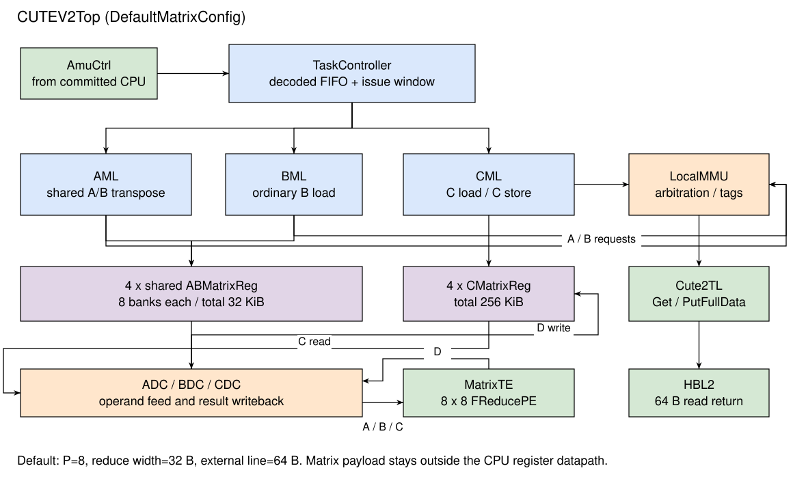

# CUTE 矩阵计算单元

## 术语说明

Table: CUTE 术语说明 {#tbl:cute-terms}

| 术语 | 描述 |
| --- | --- |
| CUTE | 接收控制核异步矩阵命令、执行矩阵加载、乘加和存储的计算单元 |
| TaskController | 矩阵任务的译码、依赖维护、发射和退休模块 |
| MatrixReg | CUTE 内部采用 SRAM 实现的矩阵寄存器；分为共享的 AB 寄存器和累加用 C 寄存器 |
| MemoryLoader | 外部存储器与 MatrixReg 之间的数据搬运模块；AML、BML 分别处理 A、B 加载，CML 处理 C 加载和结果存储 |
| DataController | MatrixReg 与计算阵列之间的供数、取数和地址控制模块；分别记为 ADC、BDC、CDC |
| MTE | MatrixTE，由多个归约乘加单元 FReducePE 构成的计算阵列 |
| 归约块 | 一次向每个 PE 提供的 A、B 向量，默认各 32 B；其元素数由数据类型决定 |
| 任务完成 | 对应 MemoryLoader 或 DataController 的完成握手，或调度器内的 Release/NopLike 完成 |
| 任务退休 | TaskController 从发射窗口头释放已完成的任务；与控制核 ROB 提交分别维护 |

## 功能

CUTE 在控制核之外执行矩阵数据搬运和矩阵乘加。控制核通过 `AmuCtrlIO` 下发已经确定操作数、矩阵寄存器编号、形状和数据类型的命令；CUTE 维护这些命令之间的矩阵寄存器依赖，将就绪任务发往不同执行模块。矩阵数据留在 CUTE 的 MatrixReg 中，计算输入和输出不经过控制核的标量寄存器堆。

矩阵乘加的基本操作为 `C ← A × B + C`。A 和 B 共用四个 AB MatrixReg，C 使用另外四个 C MatrixReg。每条计算命令读取两个不同编号的 AB 寄存器和一个 C 寄存器，并将累加结果写回同一个 C 寄存器。ADC、BDC 分别占用所选 AB 寄存器的读端口，端口约束见 [矩阵寄存器](MatrixReg.md)。软件按矩阵分块组织独立的加载、计算和存储命令，TaskController 负责这些命令的调度。

TaskController 允许没有依赖且执行资源不同的任务重叠执行。对同一个矩阵寄存器的读写按任务年龄建立依赖；AB 操作数被计算阵列读完后，可以提前允许后续加载覆盖，从而使下一批操作数加载与前一批计算流水线排空重叠。

## 总体设计

{#fig:cute-overview}

[@fig:cute-overview] 中，控制命令进入 TaskController，外部数据通过 LocalMMU 和 Cute2TL 访问 HBL2。AML/BML 将 A、B 数据写入所选 AB MatrixReg；CML 将初始累加矩阵装入 C MatrixReg，或将结果写回外部存储器。ADC、BDC 向 MTE 提供 A、B 向量，CDC 提供 C 块并接收结果 D。各模块通过任务配置接口和完成握手协作。

Table: CUTE 子模块列表 {#tbl:cute-submodules}

| 子模块 | 功能 |
| --- | --- |
| TaskController | 命令缓冲、发射窗口、矩阵寄存器依赖、执行资源占用、完成汇合和按序退休 |
| ABMatrixReg | 四个共享 A/B 存储体，提供按 bank 写入和整组向量读取 |
| CMatrixReg | 四个 C 存储体，支持计算读改写、初始值加载和结果读取 |
| AMemoryLoader/BMemoryLoader | 默认普通 A/B 加载；AML 封装还承接 A/B 共用的转置加载引擎和 AB 清零 |
| TransposeLoadEngine | 按响应标签收集源行，经两槽缓冲和转置写回流水线写入 AB 寄存器 |
| CMemoryLoader | 默认 C 普通/转置加载、C 清零、普通/转置存储及写应答等待 |
| ADataController/BDataController | 生成 AB 读地址、保存受反压的 SRAM 返回、向阵列供数 |
| CDataController | 生成 C 读地址、向阵列提供累加值、接收 D 并写回 C |
| MatrixTE/FReducePE | 默认 8×8 个 PE，同一行广播 A、同一列广播 B，每个 PE 计算一组向量点积加 C |
| LocalMMU | 各访问流仲裁、事务标识分配和来源标签编码、响应分流 |
| Cute2TL | 将内部访存请求转换为 TileLink 请求，并合并矩阵数据返回与普通应答 |

LocalMMU 将请求地址直接送往 Cute2TL，负责请求仲裁和事务标识管理。命令基地址由控制核 MLSU 翻译后提供，loader 据此生成各行请求地址。Cute2TL 的矩阵读数据使用独立的 `matrix_data_in` 通道，请求标识通过 HBL2 扩展字段传递。接口细节见 [访存接口与系统集成](Integration.md)。

## 默认参数

XSAI `DefaultMatrixConfig` 采用 `CUTE_8Tops_128SCP` 的阵列和存储几何参数，并以控制核 `MatrixExtension` 设置 CUTE 的指令能力开关。以下参数决定静态硬件规模；实际吞吐量还取决于工作频率、任务形状和供数状态。

Table: CUTE 默认参数 {#tbl:cute-default-params}

| 参数或资源 | 默认值 | 含义 |
| --- | --- | --- |
| `Tensor_MN` | 128 | AB 外层维度和 C 的 M、N 存储容量 |
| `Tensor_K` | 64 B | 每个 AB 逻辑行的归约维存储容量；INT8/FP8 为 64 个元素，BF16 为 32 个元素 |
| `Matrix_MN` | 8 | 阵列 M、N 两个方向的 PE 数，也是 MatrixReg 逻辑 bank 数 |
| `ReduceWidthByte` | 32 B | 每个 PE 每次接收的 A、B 向量宽度 |
| `ResultWidthByte` | 4 B | C、D 元素宽度 |
| `outsideDataWidth` | 512 bit | 外部一次数据传输为 64 B |
| AB MatrixReg | 4×8 KiB | 四个共享 A/B 寄存器，共 32 KiB |
| C MatrixReg | 4×64 KiB | 四个累加寄存器，共 256 KiB |
| `TaskCtrlIssueWindowDepth` | 8 | 发射窗口深度；前级 decoded FIFO 深度相同 |
| `MsyncRegs` | 32 | 控制核同步寄存器数 |
| `LoaderBridgeChannelConfig` | `ALBLCLLCSL` | A、B、C load、C store 均采用默认 legacy 实现 |
| `EnableMatrixPrefetch` | false | 默认不生成矩阵引导预取接口和标签 |

AB 与 C 的容量、bank 布局及单口 SRAM 限制见 [矩阵寄存器](MatrixReg.md)。普通加载采用 legacy 实现时，经内部通道 0 发出外部请求；多通道请求用于转置引擎或参数化 loader。

## 数据类型

Table: 默认矩阵乘加类型 {#tbl:cute-default-types}

| A、B 输入 | 累加和结果 | 默认配置 |
| --- | --- | --- |
| INT8/UINT8 的四种有符号组合 | INT32 | 开启 |
| FP8 E4M3×E4M3 | FP32 | 开启 |
| FP8 E5M2×E5M2 | FP32 | 开启 |
| BF16 | FP32 | 开启 |
| FP16 | FP32 | 关闭 |
| TF32 | FP32 | 关闭 |
| 16 bit 累加、INT4、FP32×FP32、块缩放格式 | — | 未启用 |

上述类型由 TaskController 派发到 FPE。默认 MMA 将 AfterOps 控制位设为关闭，结果直接写回 C；Scale loader/controller 的任务 valid 保持为 false。Arith 类命令执行矩阵寄存器清零，其余操作按 `NopLike` 完成。FPE 的数值处理见 [计算数据通路](Compute.md)。

## 形状与访问边界

默认计算使用 `8 <= M <= 128` 且 M 按 8 对齐、`N = 128`、A/B 每行归约维为 64 B，即 INT8/FP8 的 `K = 64` 或 BF16 的 `K = 32`。CDC 要求 N 为 `Tensor_MN`；M 在控制器中向 PE 宽度补齐。加载时未覆盖的字节保留旧值，补齐区域需要在计算前准备有效数据。

AB loader 按每逻辑行两个 entry 的固定间距写入，DataController 按任务 K 的归约块数计算行组地址。两条路径在默认 64 B 归约维上使用相同布局；短 K 的地址和尾部数据需要另行满足控制器访问范围。具体要求见 [计算形状限制](Compute.md#sec:cute-compute-shape) 与 [存储边界](MemoryLoader.md#sec:cute-store-boundary)。

## 章节组织

- [任务控制 TaskController](TaskController.md)：命令入口、依赖掩码、发射、完成和 Release。
- [矩阵寄存器 MatrixReg](MatrixReg.md)：AB/C 容量、地址映射、SRAM 端口和读写时序。
- [矩阵加载与存储 MemoryLoader](MemoryLoader.md)：普通加载、转置、清零、结果重排和参数化通道。
- [计算数据通路](Compute.md)：控制器遍历、广播阵列、FPE 流水线和数值行为。
- [访存接口与系统集成](Integration.md)：请求标识、TileLink 扩展、返回路径和同步边界。
- [性能事件与调试](Performance.md)：硬件事件含义、统计口径和任务追踪。

## 实现对应

本章对应 [XSAI DefaultMatrixConfig](https://github.com/OpenXiangShan/XSAI/blob/ee268923b717/src/main/scala/top/Configs.scala)、[CUTE 参数定义](https://github.com/OpenXiangShan/CUTE/blob/d27b93d61c359478f4202f8f42cbfe82c830912a/src/main/scala/CUTEParameters.scala) 和 [CUTE 顶层连接](https://github.com/OpenXiangShan/CUTE/blob/d27b93d61c359478f4202f8f42cbfe82c830912a/src/main/scala/CUTETOP.scala)。
