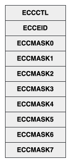
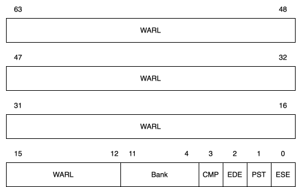
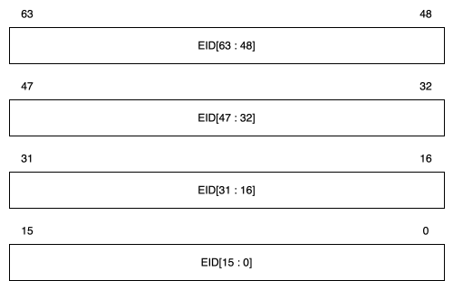
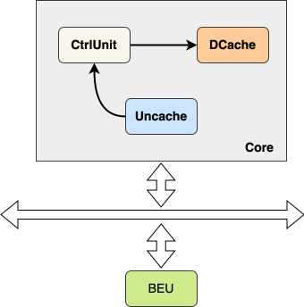
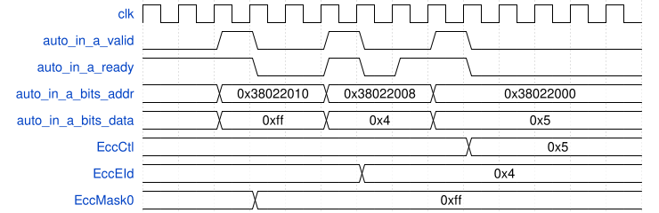
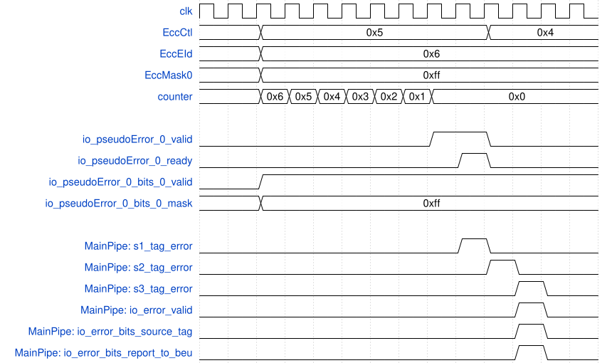
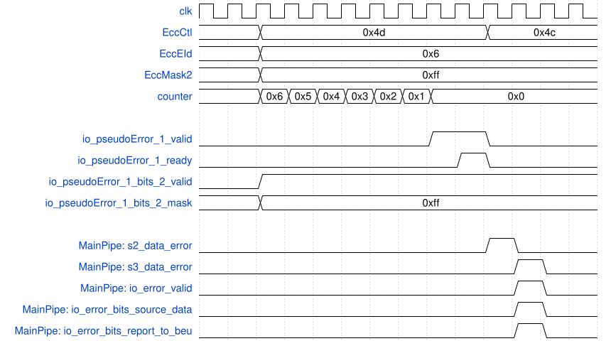

# 错误处理与自定义故障注入指令

## 功能描述

CtrlUnit 用于控制 DCache 的 ECC 错误注入。每个核的 L1 DCache 配置一个 MMIO 寄存器控制器，每个支持 ECC 的硬件单元设置一个 Control Bank。软件通过 MMIO 访存指令读写配置寄存器。配置完成后，L1 DCache 会在后续读访问（例如 Load 或 MainPipe）中触发注入的错误。具体支持范围和限制见[ECC、总线错误与 RNMI](../../ras.md)。

### 特性 1：地址空间

* 地址空间0x38022000-0x3802207F，总共128字节空间，该空间为每个hart的局部空间。

### 特性 2：DCache Control Bank

* 如图\ref{fig:CtrlBank}所示，每一个 Control Bank 包含寄存器：ECCCTL、ECCEID、ECCMASK，每一个寄存器是 8 字节。

{#fig:CtrlBank width=17%}

* ECCCTL（ECC Control）：ECC 注入控制寄存器

  {#fig:EccCtrl width=50%}

  * ese（error signaling enable）：表示注入有效，初始化为 0。当注入成功后，ese将拉低。

  * pst：支持注入信号。当pst=1时，ECCEID计数器减到0并且成功注入后，注入计时器会被恢复到上一次设置的ECCEID，重新注入；当pst==0时，只注入一次。

  * ede（error delay enable）：表示counter有效，初始化为0。如果

    * ese==1并且ede==0，则error注入立即有效。

    * ese==1并且ede==1，则需要等到ECCEID递减到0之后，注入才有效。

  * cmp（component）：表示注入对象，初始化为 0。

    * 1’b0: 注入对象为tag

    * 1’b1: 注入对象为data

  * bank：bank有效信号，初始化为0，bank中的位置位时，对应mask有效

* ECCEID（ECC Error Inject Delay）：ECC 注入延迟控制器。

  {#fig:EccEid width=50%}

  * 当 ese==1并且ede==1时，开始递减，直至减为0。目前采用和核频率相同的时钟，也可以分频。由于ECC注入依赖DCache的访问，所以EID的时间和ECC错误触发的时间可能不一致。

* ECCMASK（ECC Mask）：ECC注入掩码寄存器。

  {#fig:EccMask width=50%}

  * 0 表示不反转，1 表示翻转。tag注入只使用ECCMASK0中对应tag长度的位, 超出部分不起作用。

### 特性 3: Bus Error Unit控制器

* DCache 检测到的本地 ECC 错误在满足报告条件时发送到 Bus Error Unit 控制器处理。Bus Error Unit 控制器保存的信息有：

  Table: Bus Error Unit保存的信息

  | Field               |  描述                   |     初始值    |   地址     |
  |---------------------|------------------------|--------------|------------|
  | cause               | 错误事件的原因           |   0          | 0x38010000 |
  | value               | 错误事件的物理地址        |  未定义       | 0x38010008 |
  | enable              | 事件捕获有效掩码         |  0xF         | 0x38010010 |
  | global_interrupt    | 全局中断使能掩码          |  0           | 0x38010018 |
  | accrued             | 累积事件掩码             |  0           | 0x38010020 |
  | local_interrupt     | Hart 本地中断启用掩码     |  0           | 0x38010028 |

  `enable` 只控制事件是否有资格更新 `cause` 和 `value`，不直接控制 `accrued` 的更新或中断输出。当前四个事件源依次为 I_ECC、D_ECC、U_ECC 和 L2_ECC，因此其复位值均为 1 时，寄存器低四位为 `0xF`。本地中断条件为 `(accrued & local_interrupt) != 0`，全局中断条件为 `(accrued & global_interrupt) != 0`；两种中断掩码复位值均为 0。事件被记录后是否产生 NMI，还取决于对应的掩码和 `mnstatus.NMIE`。

  `cause` 和 `value` 只保存一份记录，而 `accrued` 按事件源累积。当前 I_ECC 的事件编号也是 0，且硬件仅在 `cause == 0` 时接受新的记录，因此 `cause == 0` 不能独立表示没有错误；软件应同时检查 `accrued`。`accrued` 按普通读写寄存器访问。

  * 地址空间

    Bus Error Unit物理地址空间为：0x38010000 - 0x38010fff

  * 支持错误类型

    * ICache Ecc Error

    * DCache Ecc Error

    * Uncache Ecc Error（U_ECC，报告 Uncache Store 返回的 denied/corrupt）

    * L2Cache Ecc Error

  * 控制的中断

    * 局部中断：只能报告给Bus Error Unit所在的Hart, 上报至后端，有后端负责中断处理，目前采用NMI_31中断。

    * 全局中断：如果出现全局中断,Bus Error Unit将中断信息发送给PLIC，由PLIC负责上报中断。

### 特性 4：L1 DCache Ecc 错误处理流程

* 报告错误

  * Tag ECC 错误：在需要 Tag 的访问路径中，只要参与判断的 way 出现 ECC 错误，就认为该请求发生 Tag ECC 错误；实际报告还受操作类型限制。

    Table: Tag ECC错误与Tag命中关系

    | Hit |  Error | Tag Error|
    |-----|--------|----------|
    |N    |N       | N        |
    |N    |Y       |Y (probably hit) |
    |Y    |N       |N         |
    |Y    |Y(hit with error) | Y |
    |Y    |Y(hit with no error) | N |

    表中Tag Hit 和 Tag ECC Error 与判断结果之间的关系

    * Data ECC 错误：命中行如果出现 ECC 错误，则认为出现 ECC 错误，如果不命中则不处理。

    * 本地 ECC 错误是否生成精确同步异常取决于访问路径。对于普通 Load，`EnableAccurateLoadError` 默认关闭，此时本地 ECC 主要通过 BEU 报告；开启并满足 `cache_error_enable` 等条件后才使用延迟错误形成 Hardware Error。来自下级总线的 denied/corrupt 使用独立路径，不受该参数控制。

    * 有效的本地 ECC 错误需要向 BEU 发送错误信息，但部分非 miss Store 和非 LR Atomic 路径会抑制 MainPipe 的报告。错误事件被 BEU 记录后，还须满足本地中断掩码和 RNMI 接收条件才可能产生 NMI。

* 普通访存指令

  * 对于普通 Load，本地 Tag/Data ECC 错误会发送到 BEU。精确的 Hardware Error（19）路径受 `EnableAccurateLoadError` 控制，且当前默认关闭。下级 TL denied 产生 Load Access Fault（5），仅 corrupt 产生 Hardware Error（19）。

* Probe/Snoop

  * 对于 Probe/Snoop

    * 如果出现 tag ecc error，不需要更改 cache 状态，并且需要向 l2 返回 corrupt=1 的 ProbeAck请求。

    * 如果出现 data ecc error，按规则更改 cache 状态，如果需要返回数据，则需要向 l2 返回 corrupt=1 的 ProbeAckData请求。

* Replace/Evict

  * 对于 Replace/Evict，

    * 如果出现 tag ecc error, 需要向l2返回corrupt=1的Release请求。

    * 如果出现 data ecc error, 需要向 l2 返回 corrupt=1 的 ReleaseData请求。

* Store to DCache

  * 对于 Sbuffer 写入数据至 DCache

    * 如果出现 tag ecc error，则根据 Repalce/Evict 流程释放 cacheline，并将数据写入 dcache 中，不向 l2 报送错误。

    * 如果出现 data ecc error，则直接写入数据，不向 l2 报送错误

    * 当前 StorePipe 地址试探路径的 `error` 和响应中的 `tag_error` 固定为 0。非 miss Store 进入 MainPipe 时也会抑制该次本地错误报告。

* Atomics

  * 对于 Atomic，下级 TL denied 按操作类型产生 Load/Store Access Fault，仅 corrupt 产生 Hardware Error。MainPipe 的本地 ECC 位于独立错误字段，当前 AtomicsUnit 不直接消费该字段，不能将本地 ECC 与下级 TL 错误统一描述。

* 多错误选择

  * 如果同时出现多个错误，当前汇聚优先级为 MainPipe > ldu0 > ldu1 > ldu2；硬件选择一条错误信息送往 BEU。

\newpage
## 整体框图

{#fig:CtrlUnit width=40%}

## 接口时序

### 配置寄存器时序

* 可以通过tilelink接口读写配置寄存器，如图\ref{fig:DCache-Error-Config-Timing}, A通道传递写地址和数据。

  * 配置地址为0x38022010的EccMask0寄存器，写入的数据为0xff;

  * 配置地址为0x38022008的EccEid寄存器，写入的数据为0x4;

  * 配置地址为0x38022000的EccCtl寄存器，写入的数据为0x5

{#fig:DCache-Error-Config-Timing width=80%}

### Tag注入时序

* 如图\ref{fig:DCache-Error-TagInj-Timing}所示，当配置好寄存器（EccCtl, EccEid和EccMask0）之后，当计时器计时到0，开始注入：

  * tag注入接口io_pseudoError_0_valid拉高，

  * 当注入成功后（即io_pseudoError_0_valid && io_pseudoError_0_ready == 1），EccCtl的ese位将清零，结束注入；

  * 以MainPipe为例，s1_tag_error、s2_tag_error和s3_tag_error逐级拉高，最后通过io_error端口向BEU报告错误信息

{#fig:DCache-Error-TagInj-Timing width=80%}

\newpage

### Data注入时序

* 如图\ref{fig:DCache-Error-DataInj-Timing}所示，当配置好寄存器（EccCtl, EccEid和EccMask2）之后，当计时器计时到0，开始注入：

  * tag注入接口io_pseudoError_1_valid拉高，

  * 当注入成功后（即io_pseudoError_1_valid && io_pseudoError_1_ready == 1），EccCtl的ese位将清零，结束注入；

  * 以MainPipe为例，s2_data_error和s3_data_error逐级拉高，最后通过io_error端口向BEU报告错误信息

{#fig:DCache-Error-DataInj-Timing width=80%}
