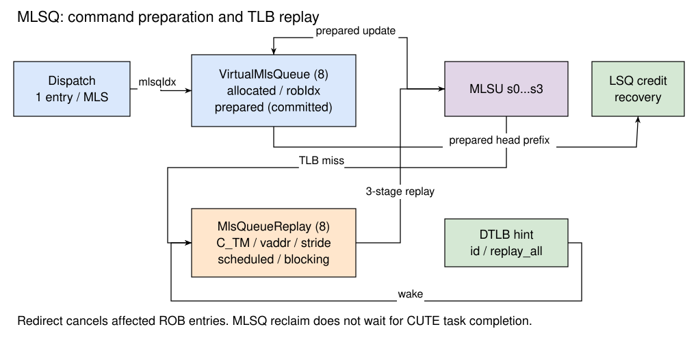

# 矩阵访存队列 MLSQ

## 功能描述

矩阵访存队列 `MlsQueue` 管理控制核中的矩阵访存指令，记录已分配的指令是否完成地址准备，并保存因 TLB 缺失而需要重新执行的请求。它由 VirtualMlsQueue 和 MlsQueueReplay 两部分组成，不存储矩阵数据。

VirtualMlsQueue 的准备完成标志与 CUTE 的任务完成不同。前者在 MLSU 返回无重发的地址准备结果时置位；后者发生在已提交的矩阵命令被 CUTE 接收并完成数据搬运之后。MLSQ 的回收不等待 CUTE 数据返回。

## 子模块列表

Table: 矩阵访存队列子模块 {#tbl:MLSQ-submodules}

| 子模块 | 功能 | 默认项数 |
| --- | --- | --- |
| VirtualMlsQueue | 按程序序分配矩阵访存指令，记录地址准备状态，回收连续完成的队首项 | 8 |
| MlsQueueReplay | 保存 TLB 缺失请求，等待唤醒后重新送入 MLSU | 8 |

两个队列的状态和容量分别管理。它们也不同于按 ROB 索引组织的 AmuCtrlBuffer，以及 CUTE 内部的任务发射窗口。

## 总体设计

矩阵访存队列与 MLSU 的连接关系如 [@fig:MLSQ-overall] 所示。

{#fig:MLSQ-overall}

分派时，矩阵访存指令在 LSQ 分配掩码中使用独立的 bit2，并取得 `mlsqIdx`。标量和向量 Load / Store 仍分别使用原有的 LoadQueue、StoreQueue 分配位。每条矩阵访存指令分配一个 MLSQ 项，不按矩阵行数或元素个数分配队列项。

LSQ 分配控制器维护矩阵队列的空闲计数和分配指针。分派接收条件同时考虑 LoadQueue、StoreQueue、MLSQ 的空闲空间；重定向后根据队列反馈的取消数量恢复分配指针与计数。

## VirtualMlsQueue

### 队列项与分配

VirtualMlsQueue 为每项保存 `allocated`、ROB 索引和准备完成标志 `committed`。分配时设置 `allocated`，记录指令的 ROB 索引，并清除准备完成标志。

这里的 `committed` 是该模块内部的信号名，表示地址准备流程已经结束，不表示 ROB 已退休，更不表示矩阵 Load / Store 的外部访问已经完成。

### 准备完成与回收

MLSU s3 将指令的 `mlsqIdx`、地址准备状态和重发原因送回队列。当请求不需要重发且 `updateAddrValid` 有效时，对应项置为准备完成。

队列从队首查找连续已准备完成的项，每次最多回收 `CommitWidth` 项。遇到未完成项即停止推进；年轻项即使提前完成，也不能越过该项回收。回收数量和队首指针反馈给 LSQ 分配控制器及 MlsQueueReplay。

### 重定向恢复

重定向按每项保存的 ROB 索引确定取消范围，并清除受影响项的 `allocated`。取消数量经过寄存后用于回退分配指针。恢复过程中还要处理同拍分配和队首回收，不能简单地将所有指针清零。

## MlsQueueReplay

### 重发原因与保存信息

当前 `MlsReplayCauses` 只定义 `C_TM`，表示 TLB 缺失。重发队列使用 FreeList 分配空项，并保存以下信息：

- 原指令及 ROB、MLSQ 索引。
- 起始虚拟地址、行步长和两项矩阵规模。
- TLB hint 标识和缺失原因。
- `allocated`、`scheduled` 和 `blocking` 状态。

首次发生 TLB 缺失时分配一个重发项；再次重发仍缺失时更新原项，不重复分配。

### TLB 唤醒

正常情况下，TLB 缺失项进入阻塞状态，等待匹配 hint 标识的返回。若 TLB 发出 `replay_all`，也会解除相应阻塞。

如果 TLB hint 路径报告已满，则请求不保持在等待该 hint 的阻塞状态，以便后续重新尝试翻译。入队同拍已收到匹配 hint 时同样不再等待，避免丢失唤醒。

### 选择与重发流水线

可以重发的项必须已分配、尚未被调度且未阻塞。选择逻辑优先考虑靠近 VirtualMlsQueue 队首的就绪项，否则按入队年龄选择。该选择不是简单地遍历物理数组下标。

重发分为三级：选择队列项，读取保存的虚拟地址与指令信息，将请求送回 MLSU。选中项设置 `scheduled`，避免在该次执行结果返回前重复发出。MLSU 仍需对首次发射与重发请求进行仲裁，重发队列的输出有效不等于当拍已经进入 MLSU。

连续重发还受冷却计数控制。TLB 缺失时长、hint 返回、选择流水线及 MLSU 背压都会影响实际重发延迟，因此不能用固定周期数描述整个重发过程。

### 释放与取消

重发结果不再需要重发，或产生非 TLB 缺失的异常时，释放对应的重发项。若仍需重发，则清除 `scheduled` 并更新阻塞和 hint 信息。重定向也会按 ROB 索引释放受影响的项。

当前 MLSQ 不执行标量 Load 的 RAW / RAR 违例检查，也没有 DCache 缺失重发项；矩阵数据的存储一致性和完成同步由 CUTE、二级缓存及矩阵同步指令的相应机制处理。

## 对应实现

- [MlsQueue.scala](https://github.com/OpenXiangShan/XSAI/blob/e8fb1a14fc85e05696e8b69a4ebfd2ca7cd1672f/src/main/scala/xiangshan/mem/lsqueue/MlsQueue.scala)
- [VirtualMlsQueue.scala](https://github.com/OpenXiangShan/XSAI/blob/e8fb1a14fc85e05696e8b69a4ebfd2ca7cd1672f/src/main/scala/xiangshan/mem/lsqueue/VirtualMlsQueue.scala)
- [MlsQueueReplay.scala](https://github.com/OpenXiangShan/XSAI/blob/e8fb1a14fc85e05696e8b69a4ebfd2ca7cd1672f/src/main/scala/xiangshan/mem/lsqueue/MlsQueueReplay.scala)
- [LsqWrapper.scala](https://github.com/OpenXiangShan/XSAI/blob/e8fb1a14fc85e05696e8b69a4ebfd2ca7cd1672f/src/main/scala/xiangshan/mem/lsqueue/LsqWrapper.scala)
