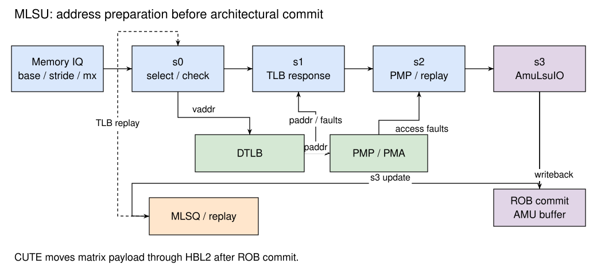

# 矩阵访存指令执行单元 MLSU

## 功能描述

矩阵访存指令执行单元 `MlsUnit` 接收访存发射队列发出的矩阵 Load / Store 指令，完成基址翻译、权限检查和访存描述符生成，并将结果写回后端。MLSU 处理的是矩阵访存指令的控制信息；矩阵数据在指令提交后由 CUTE 的加载和存储单元通过二级缓存搬运，不经过 MLSU 的数据通路。

矩阵访存分为三个阶段：MLSU 准备访存描述符，ROB 提交后经 AmuCtrlBuffer 向 CUTE 发送描述符，CUTE 执行实际的数据搬运。因此，MLSU 写回、ROB 提交和矩阵数据搬运完成是三个不同的事件。矩阵任务的执行和完成关系见 [CUTE 矩阵单元](../../cute/index.md)。

## 设计规格

- 支持 A、B、C 矩阵寄存器的 Load / Store 控制请求，以及译码表中定义的转置和整寄存器访存形式。
- 接收整数寄存器提供的基址与步长、mx 寄存器提供的矩阵规模，以及译码时保存的矩阵类型配置。
- 使用 MemBlock 的 Load DTLB 请求端口和对应的 PMP 检查端口；Load / Store 通过 TLB 命令区分权限。
- 支持 TLB 缺失后的 MLSQ 重发，以及重定向后的流水线取消。
- 默认配置例化 1 条 MLSU 流水线；VirtualMlsQueue 和 MlsQueueReplay 各为 8 项。

当前实现只在 MLSU 中翻译起始基址。对齐检查的条件固定为有效，尚未实现矩阵地址的非对齐检查；Load / Store 触发器的实例化也尚未接入。不能由标量访存支持的非对齐、MMIO 或跨页功能推导矩阵访存具有相同能力。

控制核译码表包含 A / B Store，但当前 CUTE 的 Store 任务统一送往 CML，并以矩阵号低两位选择 C 寄存器，没有独立的 A / B 数据写回通路。因此，MLSU 能生成相应控制描述符不表示 A / B Store 已实现；当前矩阵数据写回应按 C Store 路径理解。

## 总体设计

MLSU 包含 s0～s3 四级流水线，其功能如 [@fig:MLSU-pipeline] 所示。

{#fig:MLSU-pipeline}

Table: MLSU 各级流水线功能 {#tbl:MLSU-stages}

| 流水级 | 主要功能 | 输出 |
| --- | --- | --- |
| s0 | 仲裁首次发射与 MLSQ 重发，选择基址、步长和规模，检查矩阵号及规模，发送 DTLB 请求 | 虚拟基址与指令信息 |
| s1 | 接收 DTLB 结果，生成物理基址，收集页故障、客户机页故障和访问故障 | 物理基址、TLB 缺失和异常信息 |
| s2 | 整合 PMP / PMA 结果，判断是否重发，生成发射队列反馈 | 权限检查结果与重发原因 |
| s3 | 更新 MLSQ，生成 AmuLsuIO，向后端写回指令控制结果 | 矩阵访存描述符与异常信息 |

### s0：请求仲裁与地址翻译请求

s0 的请求来源包括发射队列的首次发射和 MlsQueueReplay 的重发。通常优先处理重发请求；如果当前首次发射的指令比重发指令更老，则暂缓该重发，让更老的指令先执行。

首次发射的基址来自 `src(0)`，普通访存的行步长来自 `src(1)`，两项规模来自 `src(2)` 和 `src(3)`。规模的含义随目标矩阵变化：A 为 M、K，B 为 K、N，C 为 M、N。重发保留原指令、虚拟基址、步长和两项规模，再次进入同一翻译路径。

这里的两项规模是架构矩阵形状，不总是源内存的行数和每行元素数。CUTE 的普通 B 加载以 N 为外层、K 为连续维，转置 B 则从 K 行、每行 N 个元素的源矩阵加载。`stride` 按实际源内存的相邻行起点计算。

Table: A / B 加载描述符与源内存布局 {#tbl:MLSU-source-layout}

| 加载形式 | 描述符 `row`、`column` | 源内存行数 | 每行连续元素数 |
| --- | --- | --- | --- |
| 普通 A | M、K | M | K |
| 转置 A | M、K | K | M |
| 普通 B | K、N | N | K |
| 转置 B | K、N | K | N |

TaskController 按转置标志和 A / B 类别解释这些规模，再配置普通 loader 或共享转置引擎。因此，不能仅根据 B 描述符的 `row=K`、`column=N` 将普通 B 源内存解释为 K×N 的行优先布局。相关地址生成和 bank 映射见 [矩阵加载与存储](../../cute/MemoryLoader.md)。

整寄存器访存不读取普通的行步长和 mx 规模。其步长由寄存器种类确定：A / B 使用 `TRLEN / 8`，C 使用 `ARLEN / 8`；输出描述符的规模在 s3 中生成。

s0 检查矩阵寄存器号是否与 A / B 或 C 类型匹配。非整寄存器访存还根据元素位宽和 `ROWNUM`、`TRLEN`、`ARLEN` 检查各维上界。该检查确定控制核是否接受指令，并不表示 CUTE 的所有尺寸和尾块组合均已实现；计算与存储布局的限制见 CUTE 专章。

DTLB 请求的虚拟地址为起始基址，Load 使用 `TlbCmd.read`，Store 使用 `TlbCmd.write`。当前矩阵请求不作为 hypervisor 专用访存指令发出，`hyperinst` 为无效。

### s1：接收 DTLB 结果

s1 接收 DTLB 返回的物理地址和缺失信息。Load 收集 `loadPageFault`、`loadGuestPageFault`、`loadAccessFault`，Store 收集对应的 Store 异常。指令的 ROB 索引随流水线传递，用于在重定向时取消受影响请求。

MLSU 不在这一阶段向 DCache 查询矩阵数据，也不查询 StoreQueue 或 SBuffer 做矩阵数据前递。矩阵访存与标量存储的顺序关系需要由软件按矩阵同步机制安排，不能套用标量 Load 的 Store-to-Load 前递路径。

### s2：权限检查与重发判断

s2 将 PMP 返回的 Load / Store 访问故障与已有异常合并。若 DTLB 缺失，则清除尚不能确定的异常结果，并将指令标记为 `C_TM` 重发。当前矩阵重发原因只有 TLB 缺失，没有标量 Load 的 DCache 缺失、bank 冲突或数据前递失败等原因。

MLSU 同时向发射队列反馈重发队列是否能接收请求等信息。成功完成翻译和权限检查的指令可以继续写回；需要重发的指令由 [矩阵访存队列 MLSQ](./LSQ/MLSQ.md) 保留和重新发射。

### s3：描述符生成与写回

s3 向 MLSQ 更新地址准备状态，并组装 `AmuLsuIO`。描述符包含读写方向、目标矩阵号、元素位宽、物理基址、行步长、转置标志、矩阵种类和两项规模。

Table: MLSU 生成的矩阵访存控制信息 {#tbl:MLSU-descriptor}

| 字段 | 含义 |
| --- | --- |
| `ls` | 是否为 Store |
| `ms` | 指令指定的矩阵寄存器号 |
| `widths` | 普通访存来自 mcfg 类型；整寄存器 A / B 为 8 bit，C 为 32 bit |
| `baseAddr` | DTLB 返回的物理基址 |
| `stride` | 普通访存的行步长，或整寄存器访存生成的步长 |
| `transpose` | 是否为转置访存 |
| `isA` / `isB` / `isacc` | A、B 或 C 矩阵选择 |
| `row` / `column` | 普通访存的两项规模，或整寄存器访存的固定规模 |

整寄存器 C 访存的 `row` 为 `ROWNUM`，`column` 为 `ARLEN / 32`。整寄存器 A 的规模为 `ROWNUM × (TRLEN / 8)`；B 的描述符使用 `(TRLEN / 8) × ROWNUM`。整寄存器 B 加载仍采用普通 B 的源布局：默认描述符为 64×128，源内存实际为 128 行、每行 64 个字节，行步长为 64 B。

普通 C 访存可以根据 mcfg 生成不同的 `widths`，但该字段不表示 CUTE 已实现结果类型转换或压缩存储。默认 CML 的存储重排数据为 32 bit 元素，当前有效数据写回范围见 [C 存储边界](../../cute/MemoryLoader.md#sec:cute-store-boundary)。

写回结果通过普通的后端异常与提交路径处理。正常退休的矩阵控制请求由 AmuCtrlBuffer 转发给 CUTE；异常或重定向影响的未退休指令不能依靠 MLSU 写回就产生矩阵数据搬运。MLSU 的写回数据本身不包含矩阵数据。

## 地址与异常边界

MLSU 检查起始基址的地址翻译和权限，并携带步长与规模生成后续请求。当前 CUTE LocalMMU 负责请求仲裁和事务标识路由，没有页表遍历或逐行虚实地址翻译。因此，不能把起始基址翻译成功描述为整个跨页矩阵区域已完成翻译和权限检查。

同样，当前 512 bit 矩阵返回接口没有传递 TileLink `denied` / `corrupt` 的字段，Cute2TL 也没有把这些错误转换为控制核的精确矩阵异常。这里的异常说明只覆盖控制核在发送任务前生成的异常。

## 对应实现

- [MlsUnit.scala](https://github.com/OpenXiangShan/XSAI/blob/e8fb1a14fc85e05696e8b69a4ebfd2ca7cd1672f/src/main/scala/xiangshan/mem/pipeline/MlsUnit.scala)
- [MemBlock.scala](https://github.com/OpenXiangShan/XSAI/blob/e8fb1a14fc85e05696e8b69a4ebfd2ca7cd1672f/src/main/scala/xiangshan/mem/MemBlock.scala)
- [矩阵控制接口定义](https://github.com/OpenXiangShan/XSAI/blob/e8fb1a14fc85e05696e8b69a4ebfd2ca7cd1672f/src/main/scala/xiangshan/backend/fu/matrix/Bundles.scala)
